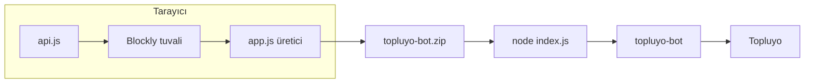
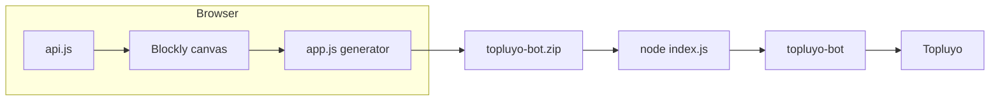

# Botluyo

[Türkçe](#türkçe) · [English](#english)

<p>
  
  
  
  
  
</p>

Kod yazmadan [Topluyo](https://topluyo.com) botu kurman için blok editörü. Canlı sürüm: [rid1-yilmaz.github.io/Botluyo](https://rid1-yilmaz.github.io/Botluyo/)

Blokları iç içe tak, sağda oluşan Node.js kodunu oku, ZIP indir. Bot çalışınca [`topluyo-bot`](https://github.com/topluyo/TopluyoBOTJS) ile Topluyo'ya bağlanır. Editör botu tarayıcıda çalıştırmaz, sadece kod üretir.

## Türkçe

### İçindekiler

- [Ne işe yarar](#ne-işe-yarar)
- [Hızlı başlangıç](#hızlı-başlangıç)
- [Arayüz](#arayüz)
- [Bloklar](#bloklar)
- [Dinle](#dinle)
- [Gelen veri](#gelen-veri)
- [API](#api)
- [Mantık, döngü, matematik](#mantık-döngü-matematik)
- [Metin](#metin)
- [Değişkenler](#değişkenler)
- [Yardımcı](#yardımcı)
- [Üretilen kod](#üretilen-kod)
- [Çoklu dosya](#çoklu-dosya)
- [ZIP](#zip)
- [Hazır botlar](#hazır-botlar)
- [Token ve güvenlik](#token-ve-güvenlik)
- [Kayıt](#kayıt)
- [API listesinin tamamı](#api-listesinin-tamamı)
- [API tablosunu güncellemek](#api-tablosunu-güncellemek)
- [Sınırlar](#sınırlar)
- [Sorun giderme](#sorun-giderme)
- [Dosyalar](#dosyalar)
- [English](#english)

Her kod başlığının altında aynı kalıp var: önce **dizilim** (hangi blok hangisinin içinde), sonra **işlev** (bot ne yapar), sonra üreticinin çıkardığı kaynak.

### Ne işe yarar

Botluyo, [Blockly 10.4.3](https://developers.google.com/blockly) üzerine kurulu bir Topluyo bot IDE'sidir. Araç kutusundaki her blok `app.js` içindeki üreticiyle JavaScript'e çevrilir.

- Mesaj, mention, form, özel mesaj, Turbo, gruba katılma, ayrılma ve atılmayı dinler.
- Bağlanınca bir kez çalışır, ya da saniye cinsinden zamanlayıcı kurar.
- Olayın içinden kullanıcı, kanal, mesaj, grup, gönderi, form ve Turbo alanlarını okur.
- `api.js` içindeki **132** [Topluyo API](https://topluyo.com/!api) ucunu blok olarak çağırır.
- Mantık, döngü, matematik, metin ve değişken bloklarını kullanır.
- Projeyi birden fazla `.js` dosyasına böler.
- Yanlış yere konmuş bloğu, koda girmeden Blockly uyarısıyla gösterir.
- `index.js`, modüller, `package.json`, `.token.json`, `.gitignore` ve kısa bir `README.md` içeren ZIP indirir.
- Tuvali bu tarayıcıda otomatik saklar.

Yapmaz:

- Botu tarayıcıda çalıştırmaz. Test için ZIP'i Node.js 18+ ile aç.
- Token'ı sunucuya göndermez. Token yalnız **Tokenli indir** dersen ZIP'teki `.token.json` dosyasına yazılır.
- API listesini kendiliğinden güncellemez. `api.js` bir anlık görüntüdür.



### Hızlı başlangıç

Editör hazır: [rid1-yilmaz.github.io/Botluyo](https://rid1-yilmaz.github.io/Botluyo/)

1. Sayfayı aç.
2. **🎧 Dinle** içinden bir olay çıkar, yapılacak işi onun içine tak. Boşta duran blok koda yazılmaz.
3. Sağdaki önizlemede uyarıya ve koda bak.
4. **📦 Botu Hazırla** ile ZIP indir.
5. Çalıştır:

```bash
unzip topluyo-bot.zip -d botum
cd botum
npm install
npm start
```

`.token.json` bir JSON metnidir, nesne değildir:

```json
"BURAYA_TOKENINIZI_YAZIN"
```

İndirmeden önce girmek için **🔑 Tokenli indir**. Rumuz `bot` ile **başlamalı ya da bitmelidir** (`botMuzo`, `MuzoBot`). Token, Topluyo'da **Cihazlarım** bölümündedir. Kütüphane: [topluyo-bot](https://github.com/topluyo/TopluyoBOTJS).

**Örnek dizilim**

```text
📨 Mesaj gelince
└─ eğer  💬 Mesaj metni  =  !merhaba
   └─ 🌐 Gönderi gönder
        channel_id: 📺 Kanal ID
        text:       Merhaba!
```

**İşlev:** Birisi kanala `!merhaba` yazınca bot aynı kanala `Merhaba!` yollar.

```js
bot.on('message', async (data) => {
  if (data.action === 'post/add') {
    try {
      if (data.message == '!merhaba') {
        _son = await bot.post("/!api/post/add", { channel_id: data.channel_id, text: 'Merhaba!' });
      }
    } catch (err) {
      console.error('Blok hatası:', err);
    }
  }
});
```

### Arayüz

Sayfa iki bölmedir. 900 pikselin altında alt alta iner.

| Bölge | Ne var |
|---|---|
| Üst şerit | `🤖 Botluyo` |
| Sekmeler | `index.js`, ek dosyalar, **＋ Dosya**, `index.js` dışında **🗑️** |
| Tuval | Izgara, zoom, çöp kutusu. Başlangıç ölçeği 0.9 |
| **📦 Botu Hazırla** | İndirme penceresi |
| Dosya ağacı | Dosya seçer. `package.json`, `.token.json`, `.gitignore`, dışa aktarılan `README.md` görünür, düzenlenemez |
| Kod | Yalnızca açık dosyanın üretimi |

İndirme penceresi: yer tutuculu ZIP, parola alanına token, **Tokenli indir** (boşsa inmez), Kapat. Token alana yazılsa bile `localStorage`'a konmaz.

### Bloklar

**Şapka** (olay, bağlanma, zamanlayıcı) bir dinleyici açar. Gövdesine takılanlar o dinleyicinin içine yazılır. Dışarıda kalan blok dosyaya girmez:

> Bu blok bir olay bloğunun içinde değil, koda eklenmez.

Yanlış olayda kullanılan veri bloğu yine de yazılır, ama uyarı verir. Uyarıyı yok sayma. Her şapkanın gövdesi kendi `try/catch` içindedir. Hata `Blok hatası:` diye konsola düşer, süreç kapanmaz.

#### Dinle

Turuncu şapkalar. Mesaj türleri `bot.on('message', ...)` dinler ve `data.action` ile süzülür. Alanlar [topluyo-bot](https://github.com/topluyo/TopluyoBOTJS) olay tablosundandır.

| Blok | Dinleyici | Gelenler |
|---|---|---|
| 📨 Mesaj gelince | `post/add` | `message`, `channel_id`, `user_id` |
| 🔔 Mention (bildirim) gelince | `post/mention` | `message`, `channel_id`, `user_id` |
| 📋 Form gönderilince | `post/bumote` | `message.form`, `message.submit`, `post_id`, `user_id` |
| 💬 Özel mesaj gelince | `message/send` | `message`, `user_id` |
| 💸 Turbo transferi gelince | `turbo/transfer` | `message.quantity`, `message.message`, `transfer_id`, `user_id` |
| ➕ Gruba biri katılınca | `group/join` | `group_id`, `user_id` |
| ➖ Gruptan biri ayrılınca | `group/leave` | `group_id`, `user_id` |
| 🚪 Gruptan biri atılınca | `group/kick` | `group_id`, `user_id` |
| 🟢 Bot bağlanınca | `bot.on('connected')` | `data` yok |
| ⏰ Her N saniyede bir | `setInterval`, en az 1 sn | `data` yok |

Aynı adlı API yolu dinleyici değildir.

- **Form gönderilince** gelen formu dinler. **Gönderi → Bumote ekle** ise `/!api/post/bumote` çağırır.
- **Özel mesaj gelince** geleni yakalar. **Özel mesaj gönder** ise `/!api/message/send` çağırır.
- **Gruptan biri atılınca** haberdar eder. Sen atmak için **Üye → Üyeyi gruptan at** (`/!api/member/kick`).

`index.js` şablonu ayrıca `Bot bağlandı ✅` yazan bir `connected` dinleyicisi koyar. **Bot bağlanınca** eklersen ikisi de çalışır.

**Örnek dizilim**

```text
🔔 Mention (bildirim) gelince
└─ 🌐 Gönderi gönder
     channel_id: 📺 Kanal ID
     text:       Buyur
```

**İşlev:** Birisi botu etiketleyince bot aynı kanala `Buyur` yazar.

```js
bot.on('message', async (data) => {
  if (data.action === 'post/mention') {
    try {
      _son = await bot.post("/!api/post/add", { channel_id: data.channel_id, text: 'Buyur' });
    } catch (err) {
      console.error('Blok hatası:', err);
    }
  }
});
```

Öbür şapkaların kısa karşılığı:

| Dizilim | İşlev |
|---|---|
| 📨 Mesaj gelince → 🖨️ Konsola yaz → 💬 Mesaj metni | Her gönderiyi konsola basar |
| 📋 Form gönderilince → 🖨️ Konsola yaz → 🔘 Form buton etiketi | Basılan butonun yazısını basar |
| 💬 Özel mesaj gelince → 🌐 Özel mesaj gönder, kullanıcı 👤, message `oldu` | Gelen özel mesaja `oldu` diye cevap verir |
| 💸 Turbo transferi gelince → 🖨️ Konsola yaz → 💰 Turbo miktarı | Gelen Turbo miktarını basar |
| ➕ Gruba biri katılınca → 🖨️ Konsola yaz → 👤 Kullanıcı ID | Katılanın kimliğini basar |
| ➖ Gruptan biri ayrılınca → 🖨️ Konsola yaz → 👥 Grup ID | Ayrılmanın olduğu grubu basar |
| 🚪 Gruptan biri atılınca → 🖨️ Konsola yaz → 👤 Kullanıcı ID | Atılanın kimliğini basar |
| 🟢 Bot bağlanınca → 🖨️ Konsola yaz → `açıldım` | Bağlanınca bir kez `açıldım` yazar |
| ⏰ Her 60 saniyede bir → 🌐 Sunucu saatini getir | Dakikada bir `/!api/test/time` çağırır |

#### Gelen veri

Değer üretirler, tek başlarına satır olmazlar. Yalnızca aşağıdaki olaylarda uyarı vermezler.

| Blok | Kod | Olay |
|---|---|---|
| 👤 Kullanıcı ID (olayı yapan) | `data.user_id` | Sekiz mesaj olayının hepsi |
| 📺 Kanal ID | `data.channel_id` | Mesaj, mention |
| 💬 Mesaj metni | `data.message` | Mesaj, mention, özel mesaj |
| 👥 Grup ID | `data.group_id` | Katılma, ayrılma, atılma |
| 🧾 Gönderi ID | `data.post_id` | Form |
| 🔘 Form buton etiketi | `data.message.submit` | Form |
| 📋 Form alanı | `data.message.form[alan]` | Form |
| 💰 Turbo miktarı | `data.message.quantity` | Turbo |
| 📝 Turbo notu | `data.message.message` | Turbo |
| 🔢 Transfer ID | `data.transfer_id` | Turbo |

Form alanı bir yuva ister. İçine metin bloğuyla anahtarı yaz (`ad`). Çıktı `data.message.form['ad']` olur. Bağlanma ve zamanlayıcıda `data` yoktur.

**Örnek dizilim**

```text
📋 Form gönderilince
└─ eğer  🔘 Form buton etiketi  =  kaydet
   └─ 🖨️ Konsola yaz
        └─ 📋 Form alanı
             └─ ad
```

**İşlev:** Formda `kaydet` butonuna basılınca, formdaki `ad` alanını konsola yazar.

```js
bot.on('message', async (data) => {
  if (data.action === 'post/bumote') {
    try {
      if (data.message.submit == 'kaydet') {
        console.log(data.message.form['ad']);
      }
    } catch (err) {
      console.error('Blok hatası:', err);
    }
  }
});
```

#### API

**🌐 API (tüm özellikler)** `api.js` okununca kurulur. 21 grup, 132 blok. Her blok bir satırdır ve yanıtı `_son` içine bırakır.

```js
_son = await bot.post("/!api/post/add", { channel_id: data.channel_id, text: 'Merhaba' });
```

- Boş yuva gövdeye yazılmaz.
- `#` ile işaretli alan düz sayıysa (`'42'`) tırnak düşer, `42` kalır.
- Değişken ve `data.user_id` olduğu gibi kalır, zorla sayıya çevrilmez.
- Üçten az ya da eşit alan yatay, fazlası alt alta durur.
- `bot.post` çağrılarını `topluyo-bot` hız sınırına karşı kendi içinde toplar.

Son yanıt, **🧰 Yardımcı** içinden okunur: **📦 Son API yanıtı** → `_son`, **📦 Son yanıtın … alanı** → `_son ? _son[alan] : undefined`. `_son` dosya başına tektir. Her yeni çağrı öncekini ezer. Başka dosyanın `_son` değeri görünmez.

**Örnek dizilim**

```text
🟢 Bot bağlanınca
├─ 🌐 Kullanıcı ID'mi getir
└─ 🖨️ Konsola yaz
     └─ 📦 Son API yanıtı
```

**İşlev:** Bağlanınca `/!api/user/id` çağırır ve dönen nesneyi konsola basar. Ucun alanı olmadığı için gövde `{}` olur.

```js
bot.on('connected', async () => {
  try {
    _son = await bot.post("/!api/user/id", {});
    console.log(_son);
  } catch (err) {
    console.error('Blok hatası:', err);
  }
});
```

Uçların tamamı [aşağıda](#api-listesinin-tamamı). Adlar araç kutusundaki Türkçe yazılardır.

#### Mantık, döngü, matematik

Blockly bloklarıdır. Arayüz `msg/tr.js` ile Türkçedir.

| Kategori | Bloklar |
|---|---|
| 🔀 Mantık | eğer, karşılaştırma, ve/veya, değil, doğru/yanlış |
| 🔁 Döngü | tekrarla, şöyle iken / olana kadar, kır / devam |
| 🔢 Matematik | sayı, dört işlem, rastgele tam sayı, mod |

Karşılaştırma Blockly'nin ürettiği işleçtir (`==`, `>`, `>=`). Bitmeyen `şöyle iken` o olayı kilitler.

**Örnek dizilim**

```text
📨 Mesaj gelince
└─ eğer  💬 Mesaj metni  =  !ping
   └─ 🌐 Gönderi gönder
        channel_id: 📺 Kanal ID
        text:       pong
```

**İşlev:** `!ping` yazılınca aynı kanala `pong` yollar. `!merhaba` örneğiyle aynı iskelet, koşul ve metin değişir.

Döngü dizilimi, aynı şapkanın içinde:

```text
tekrarla 3 kez
└─ 🖨️ Konsola yaz
     └─ tik
```

**İşlev:** O olay her geldiğinde konsola üç kez `tik` yazar. Bu bir zamanlayıcı değildir. Zaman aralığı için **⏰ Her N saniyede bir** kullan.

#### Metin

| Blok | Üretir |
|---|---|
| Metin, birleştir, uzunluk | Blockly metin blokları |
| … şununla başlıyor mu | `String(a).startsWith(b)` |
| … içinde geçiyor mu | `String(a).includes(b)` |
| … metninin N. kelimesi | Boşluklardan böl, 1'den say. Yoksa `''` |

**Örnek dizilim**

```text
📨 Mesaj gelince
└─ eğer  💬 Mesaj metni  şununla başlıyor mu  !selam
   └─ 🌐 Gönderi gönder
        channel_id: 📺 Kanal ID
        text:       💬 Mesaj metni  metninin 2. kelimesi
```

**İşlev:** `!selam Ada` yazılınca bot `Ada` diye cevap verir. İkinci kelime yoksa boş metin gider.

```js
if (String(data.message).startsWith('!selam')) {
  _son = await bot.post("/!api/post/add", {
    channel_id: data.channel_id,
    text: (String(data.message).trim().split(/\s+/)[(2) - 1] ?? '')
  });
}
```

#### Değişkenler

**📦 Değişkenler** Blockly'nin kendi kategorisidir. Adı sen koyarsın. Değişken, yazıldığı dosyada ve bulunduğu fonksiyonun kapsamında kalır. `yardim.js` içindeki ad `index.js` tarafından görülmez.

Üretici şu adları ayırır: `data`, `bot`, `TOKEN`, `TopluyoBOT`, `err`, `require`, `console`, `_son`. Bunları değişken yapma.

Blockly, değişken tanımını (`var ad;`) üretilen kodun başına, şapkalardan önce koyar. Atama, takıldığın yerde durur. Önizleme kesin metindir.

**Örnek dizilim**

```text
📨 Mesaj gelince
├─ değişken ata  selam  =  💬 Mesaj metni
└─ 🖨️ Konsola yaz
     └─ değişken oku  selam
```

**İşlev:** Gelen metni `selam` içine alır, hemen ardından konsola basar. Başka bir şapka bu `selam` değerini görmez.

#### Yardımcı

| Blok | Kod |
|---|---|
| 🖨️ Konsola yaz | `console.log(...)` |
| ⏱️ Bekle | `await new Promise(r => setTimeout(r, (saniye) * 1000))` |
| 📦 Son API yanıtı | `_son` |
| 📦 Son yanıtın … alanı | `_son ? _son[alan] : undefined` |

Bekle saniye cinsindendir. Zamanlayıcı da saniyedir ama o `setInterval`'dır, bir kezlik bekleme değil. Aralık süreç kapanana kadar sürer.

**Örnek dizilim**

```text
📨 Mesaj gelince
└─ eğer  💬 Mesaj metni  =  !bekle
   ├─ ⏱️ Bekle  2
   └─ 🌐 Gönderi gönder
        channel_id: 📺 Kanal ID
        text:       geldim
```

**İşlev:** `!bekle` yazılınca 2 saniye durur, sonra aynı kanala `geldim` yazar.

```js
if (data.message == '!bekle') {
  await new Promise(r => setTimeout(r, (2) * 1000));
  _son = await bot.post("/!api/post/add", { channel_id: data.channel_id, text: 'geldim' });
}
```

### Üretilen kod

`index.js` her zaman bu iskeletle başlar. Ek dosyalar `require` ile, şapkalardan **önce** yüklenir. Şapkaların kodu alta eklenir.

```js
// index.js — Botluyo ile oluşturuldu
const TopluyoBOT = require('topluyo-bot');
const TOKEN = require('./.token.json');
const bot = TopluyoBOT(TOKEN);
let _son;

bot.on('connected', () => console.log('Bot bağlandı ✅'));
bot.on('auth_problem', () => console.error('Token geçersiz! "Cihazlarım" bölümünden yenisini alın.'));
bot.on('error', (err) => console.error('Hata:', err));

require('./yardim.js')(bot);

// şapkalar buradan sonra
```

Mesaj şapkası:

```js
bot.on('message', async (data) => {
  if (data.action === 'post/add') {
    try {
      // gövde
    } catch (err) {
      console.error('Blok hatası:', err);
    }
  }
});
```

Bağlanma `bot.on('connected', async () => { try { ... } catch ... })` olur. Alanı 60 olan zamanlayıcı `setInterval(async () => { try { ... } catch ... }, 60000)` olur.

`auth_problem` gelirse kütüphane yeniden bağlanmaz. Token'ı Cihazlarım'dan yenile. `error` soket hatasıdır. Kopunca yeniden deneme `topluyo-bot`'un işidir.

**Örnek dizilim**

Hızlı başlangıçtaki `!merhaba` botu, başka dosya yokken `index.js` olarak şöyle biter. Üstteki şablon aynen durur, alta yalnız bu dinleyici eklenir.

```js
bot.on('message', async (data) => {
  if (data.action === 'post/add') {
    try {
      if (data.message == '!merhaba') {
        _son = await bot.post("/!api/post/add", { channel_id: data.channel_id, text: 'Merhaba!' });
      }
    } catch (err) {
      console.error('Blok hatası:', err);
    }
  }
});
```

**İşlev:** Şablon bağlanınca `Bot bağlandı ✅` yazar. Ardından bu dinleyici `!merhaba` mesajına cevap verir. İkisi ayrı dinleyicidir.

### Çoklu dosya

`index.js` her zaman vardır, silinemez. **＋ Dosya** ad sorar. Ad küçülür, `çğıöşü` → `cgiosu` olur, `.js` bir kez eklenir. `index.js` ve kullanılan ad reddedilir.

Ek dosya şöyle çıkar:

```js
// yardim-menusu.js — Botluyo ile oluşturuldu
module.exports = (bot) => {
  let _son;
  // bu dosyanın şapkaları, iki boşluk içeride
};
```

Dosyalar birbirinin değişkenini ve `_son` değerini görmez. Ortak olan tek nesne `bot`'tur. Ortak bellek için **Park** (`park/set`, `park/list`, `park/del`) ya da tek dosya. Sekme değişince açık tuval Blockly serileştirmesiyle saklanır.

**Örnek dizilim**

`index.js` boş kalır. `yardim.js`:

```text
📨 Mesaj gelince
└─ eğer  💬 Mesaj metni  =  !yardim
   └─ 🌐 Gönderi gönder
        channel_id: 📺 Kanal ID
        text:       komutlar: !yardim
```

**İşlev:** `index.js` bu dosyayı `require('./yardim.js')(bot)` ile yükler. `!yardim` yazılınca yardım metni aynı kanala gider. `index.js` içindeki `_son` ile `yardim.js` içindeki `_son` ayrıdır.

### ZIP

ZIP tarayıcıda, harici kütüphane olmadan kurulur. Sıkıştırmasızdır, UTF-8 ad ve CRC32 vardır. İndirilen ad her zaman `topluyo-bot.zip`.

| Dosya | İçerik |
|---|---|
| `index.js` | Şablon + şapkaların |
| `*.js` | Varsa diğer modüller |
| `package.json` | `topluyo-bot-projesi`, `npm start` → `node index.js`, Node `>=18`, bağımlılık `topluyo-bot` @ `latest` |
| `.token.json` | Girdiğin token ya da `"BURAYA_TOKENINIZI_YAZIN"` |
| `.gitignore` | `.token.json`, `node_modules/` |
| `README.md` | Üç satırlık çalıştırma notu. Bu deponun belgesi değil |

`latest` sabit değildir. Yayınlayacağın botta, kurduğun sürümü `package.json` içine yaz.

### Hazır botlar

Her birinde dizilim, işlev ve üreticinin ilgili parçası var. Tam dosya, şablon + bu parça.

#### Kapıdaki karşılama

```text
➕ Gruba biri katılınca
└─ 🌐 Gönderi gönder
     channel_id: 12345
     text:       Hoş geldin
```

**İşlev:** Birisi gruba girince `12345` numaralı kanala `Hoş geldin` yazar. Katılma olayında kanal kimliği gelmez, numarayı sen yazarsın. Sayı alanı olduğu için `12345` tırnaksız çıkar.

```js
bot.on('message', async (data) => {
  if (data.action === 'group/join') {
    try {
      _son = await bot.post("/!api/post/add", { channel_id: 12345, text: 'Hoş geldin' });
    } catch (err) {
      console.error('Blok hatası:', err);
    }
  }
});
```

#### Turbo teşekkür

```text
💸 Turbo transferi gelince
└─ eğer  💰 Turbo miktarı  ≥  10
   └─ 🌐 Turbo gönder
        user_id:  👤 Kullanıcı ID
        quantity: 1
        message:  Teşekkürler!
```

**İşlev:** 10 veya daha fazla Turbo gelince gönderene 1 Turbo ve `Teşekkürler!` notu döner. `quantity` sayı alanıdır. `user_id` veri bloğu olduğu için ifade olarak kalır.

```js
bot.on('message', async (data) => {
  if (data.action === 'turbo/transfer') {
    try {
      if (data.message.quantity >= 10) {
        _son = await bot.post("/!api/turbo/transfer", { user_id: data.user_id, quantity: 1, message: 'Teşekkürler!' });
      }
    } catch (err) {
      console.error('Blok hatası:', err);
    }
  }
});
```

#### Özel mesaj yankısı

```text
💬 Özel mesaj gelince
└─ 🌐 Özel mesaj gönder
     user_id: 👤 Kullanıcı ID
     message: 💬 Mesaj metni
```

**İşlev:** Bota yazılan özel mesajı aynen geri yollar.

```js
bot.on('message', async (data) => {
  if (data.action === 'message/send') {
    try {
      _son = await bot.post("/!api/message/send", { user_id: data.user_id, message: data.message });
    } catch (err) {
      console.error('Blok hatası:', err);
    }
  }
});
```

#### Dakikalık saat

```text
⏰ Her 60 saniyede bir
├─ 🌐 Sunucu saatini getir
└─ 🖨️ Konsola yaz
     └─ 📦 Son API yanıtı
```

**İşlev:** Her 60 saniyede `/!api/test/time` çağırır ve yanıtı basar. `data` yoktur. Bu `message` dinleyicisi değildir.

```js
setInterval(async () => {
  try {
    _son = await bot.post("/!api/test/time", {});
    console.log(_son);
  } catch (err) {
    console.error('Blok hatası:', err);
  }
}, 60000);
```

### Token ve güvenlik

- Token cihaz anahtarıdır. Sohbete, görüntüye, issue'ya yapıştırma.
- Repodaki ve ZIP'teki `.gitignore` `.token.json` dosyasını dışlar. Yine de `git status` bak.
- **Tokenli indir** token'ı yalnız o ZIP'e yazar. İstek atmaz.
- Alan parola kutusudur, indirme bitince temizlenir.
- Sızdıysa Cihazlarım'dan yenile. Eski anahtar `auth_problem` verir.
- Üretilen bot, token sahibinin yetkisiyle çağrı yapar. Silme, atma ve Turbo gerçek işlemdir.

### Kayıt

Tuval, değişimden yaklaşık 200 ms sonra `localStorage` anahtarı `botluyo-v2` altına yazılır. Dosya listesi, seçili dosya ve Blockly çalışma alanı durur.

- Yalnızca bu tarayıcı ve bu köken. `file://` ile Pages adresi ayrı depolardır.
- Başka makineye ZIP ile gidersin. Proje JSON'u içe veya dışa aktarma düğmesi yoktur.
- Depo dolarsa kayıt sessizce kaçar. Önizleme sürer, yenileyince tuval eski kalabilir.
- `index.js` içermeyen eski kayıt yok sayılır.
- ZIP tuvalin dizilimini saklamaz, yalnız üretilmiş kaynağı saklar.

### API listesinin tamamı

Kaynak `api.js`. `#alan` sayıdır. İşaretsiz alan metin ya da serbest değerdir. Boş alan çağrıya girmez. Başlığa tıklayınca grup açılır.

**Summary:**
<b>Şikayet</b> — 1 uç nokta

| Uç nokta | Bloktaki ad | Alanlar |
|---|---|---|
| `/!api/abuse/market` | Market uygulamasını şikayet et | `app_id` *(sayı)*, `reason_text` |

**Summary:**
<b>Rozet</b> — 4 uç nokta

| Uç nokta | Bloktaki ad | Alanlar |
|---|---|---|
| `/!api/badge/add` | Rozet ekle | `group_id` *(sayı)*, `name`, `nick`, `description`, `image`, `level` |
| `/!api/badge/all` | Tüm rozetleri getir | — |
| `/!api/badge/give` | Rozet ver | `badge_id` *(sayı)*, `user_id` *(sayı)* |
| `/!api/badge/list` | Grup rozetlerini listele | `group_id` *(sayı)*, `group_nick` |

**Summary:**
<b>Kanal</b> — 10 uç nokta

| Uç nokta | Bloktaki ad | Alanlar |
|---|---|---|
| `/!api/channel/add` | Kanal oluştur | `group_id` *(sayı)*, `nick`, `title`, `description`, `type` *(sayı)*, `data`, `read_role_ids`, `write_role_ids`, `control_role_ids`, `read_plus_user_ids`, `read_minus_user_ids`, `write_plus_user_ids`, `write_minus_user_ids`, `control_plus_user_ids`, `control_minus_user_ids` |
| `/!api/channel/del` | Kanalı sil | `channel_id` *(sayı)* |
| `/!api/channel/detail` | Kanal kullanıcı izinlerini getir | `channel_id` *(sayı)* |
| `/!api/channel/get` | Kanal bilgisini getir | `channel_id` *(sayı)* |
| `/!api/channel/list` | Gruptaki kanalları listele | `group_id` *(sayı)* |
| `/!api/channel/options/set` | Kanal seçeneklerini değiştir | `channel_id` *(sayı)*, `add_read_plus_user_id` *(sayı)*, `del_read_plus_user_id` *(sayı)*, `add_read_minus_user_id` *(sayı)*, `del_read_minus_user_id` *(sayı)*, `add_write_plus_user_id` *(sayı)*, `del_write_plus_user_id` *(sayı)*, `add_write_minus_user_id` *(sayı)*, `del_write_minus_user_id` *(sayı)*, `add_control_plus_user_id` *(sayı)*, `del_control_plus_user_id` *(sayı)*, `add_control_minus_user_id` *(sayı)*, `del_control_minus_user_id` *(sayı)* |
| `/!api/channel/set` | Kanalı düzenle | `channel_id` *(sayı)*, `nick`, `title`, `description`, `type` *(sayı)*, `data`, `read_role_ids`, `write_role_ids`, `control_role_ids`, `read_plus_user_ids`, `read_minus_user_ids`, `write_plus_user_ids`, `write_minus_user_ids`, `control_plus_user_ids`, `control_minus_user_ids` |
| `/!api/channel/show` | Kanalı göster | `group_nick`, `channel_nick` |
| `/!api/channel/show/info` | Kanal bilgisini göster | `channel_id` *(sayı)*, `group_nick`, `channel_nick` |
| `/!api/channel/sort` | Kanalları sırala | `group_id` *(sayı)*, `channel_ids` |

**Summary:**
<b>Ekip</b> — 8 uç nokta

| Uç nokta | Bloktaki ad | Alanlar |
|---|---|---|
| `/!api/crew/add` | Ekip oluştur | `group_id` *(sayı)*, `name`, `color`, `image` |
| `/!api/crew/del` | Ekibi sil | `crew_id` *(sayı)* |
| `/!api/crew/get` | Ekibi getir | `crew_id` *(sayı)* |
| `/!api/crew/join` | Ekibe katıl | `crew_id` *(sayı)* |
| `/!api/crew/leave` | Ekipten ayrıl | `crew_id` *(sayı)* |
| `/!api/crew/list` | Ekipleri listele | `group_id` *(sayı)* |
| `/!api/crew/set` | Ekibi düzenle | `crew_id` *(sayı)*, `name`, `color`, `image` |
| `/!api/crew/sort` | Ekipleri sırala | `group_id` *(sayı)*, `crew_ids` |

**Summary:**
<b>Favori</b> — 2 uç nokta

| Uç nokta | Bloktaki ad | Alanlar |
|---|---|---|
| `/!api/favorite/list` | Favori kanalları listele | — |
| `/!api/favorite/toggle` | Kanalı favoriye ekle/çıkar | `channel_id` *(sayı)* |

**Summary:**
<b>Arkadaş</b> — 3 uç nokta

| Uç nokta | Bloktaki ad | Alanlar |
|---|---|---|
| `/!api/friend/add` | Arkadaş ekle / isteği kabul et | `user_id` *(sayı)* |
| `/!api/friend/del` | Arkadaşı sil | `user_id` *(sayı)* |
| `/!api/friend/status` | Arkadaşlık durumu | `user_id` *(sayı)* |

**Summary:**
<b>Grup</b> — 16 uç nokta

| Uç nokta | Bloktaki ad | Alanlar |
|---|---|---|
| `/!api/group/add` | Grup oluştur | `name`, `description` |
| `/!api/group/del` | Grubu sil | `group_id` *(sayı)* |
| `/!api/group/founder` | Grup kurucusunu getir | `group_id` *(sayı)* |
| `/!api/group/get` | Grup bilgisini getir | `id` *(sayı)*, `nick` |
| `/!api/group/join` | Gruba katılma isteği gönder | `group_id` *(sayı)* |
| `/!api/group/joinlist` | Katılma isteklerini listele | `group_id` *(sayı)* |
| `/!api/group/leave` | Gruptan ayrıl | `group_id` *(sayı)* |
| `/!api/group/list` | Gruplarımı listele | — |
| `/!api/group/online` | Çevrimiçi üyeleri getir | `group_id` *(sayı)* |
| `/!api/group/popular` | Popüler grupları getir | — |
| `/!api/group/set` | Grubu düzenle | — |
| `/!api/group/set/home` | Grup ana sayfasını değiştir | `group_id` *(sayı)*, `home` |
| `/!api/group/set/permissions` | Grup izinlerini ayarla | `group_id` *(sayı)*, `discover_me` *(sayı)*, `everyone_member` *(sayı)*, `abuse_filter` *(sayı)*, `enable_ads` *(sayı)* |
| `/!api/group/set/profile` | Grup profilini ayarla | `group_id` *(sayı)*, `name`, `image`, `description` |
| `/!api/group/set/socials` | Grup sosyal hesaplarını ayarla | `social_instagram`, `social_x`, `social_youtube`, `social_tiktok`, `social_kick`, `social_twitch`, `social_github`, `social_steam`, `social_linkedin`, `social_website` |
| `/!api/group/sort` | Grupları sırala | `group_ids` |

**Summary:**
<b>Market</b> — 18 uç nokta

| Uç nokta | Bloktaki ad | Alanlar |
|---|---|---|
| `/!api/market/api/get` | Uygulama anahtarını getir | `app_id` *(sayı)* |
| `/!api/market/api/reset` | Uygulama anahtarını sıfırla | — |
| `/!api/market/add` | Uygulama oluştur | `name`, `app_type_id` *(sayı)*, `description` |
| `/!api/market/app/install` | Uygulamayı gruba yükle | `app_id` *(sayı)*, `group_id` *(sayı)* |
| `/!api/market/comment/add` | Uygulamaya yorum ekle | `app_id` *(sayı)*, `rate` *(sayı)*, `text` |
| `/!api/market/comment/list` | Uygulama yorumlarını listele | `app_id` *(sayı)* |
| `/!api/market/get` | Uygulamayı getir | `app_id` *(sayı)* |
| `/!api/market/hide` | Uygulamayı gizle/sil | `app_id` *(sayı)* |
| `/!api/market/library/add` | Kütüphaneye ekle | `app_id` *(sayı)* |
| `/!api/market/library/del` | Kütüphaneden çıkar | `app_id` *(sayı)* |
| `/!api/market/library/list` | Kütüphanemi listele | — |
| `/!api/market/list` | Market'i listele | `app_type_ids`, `publisher_id` *(sayı)*, `search`, `verified` *(sayı)*, `limit` *(sayı)* |
| `/!api/market/myapps` | Uygulamalarımı getir | — |
| `/!api/market/publisher/get` | Yayıncıyı getir | `publisher_id` *(sayı)* |
| `/!api/market/revision/get` | Son revizyonu getir | `app_id` *(sayı)* |
| `/!api/market/revision/publish` | Revizyonu yayınla | `app_id` *(sayı)* |
| `/!api/market/revision/set/content` | Revizyon içeriğini ayarla | `app_id` *(sayı)*, `name`, `description`, `image`, `icon` |
| `/!api/market/revision/set/detail` | Revizyon ayrıntısını ayarla | `app_id` *(sayı)*, `link`, `css`, `webhook`, `app_type_id` *(sayı)* |

**Summary:**
<b>Üye</b> — 7 uç nokta

| Uç nokta | Bloktaki ad | Alanlar |
|---|---|---|
| `/!api/member/get` | Üyeyi getir | `group_id` *(sayı)*, `user_id` *(sayı)*, `user_nick` |
| `/!api/member/info` | Üyelik bilgimi getir | `group_id` *(sayı)* |
| `/!api/member/kick` | Üyeyi gruptan at | `group_id` *(sayı)*, `user_id` *(sayı)* |
| `/!api/member/list` | Üyeleri listele | `group_id` *(sayı)* |
| `/!api/member/role/set` | Üyenin rollerini ayarla | `group_id` *(sayı)*, `user_id` *(sayı)*, `role_ids` |
| `/!api/member/waiter/accept` | Katılma isteğini kabul et | `group_id` *(sayı)*, `user_id` *(sayı)* |
| `/!api/member/waiter/reject` | Katılma isteğini reddet | `group_id` *(sayı)*, `user_id` *(sayı)* |

**Summary:**
<b>Özel mesaj</b> — 5 uç nokta

| Uç nokta | Bloktaki ad | Alanlar |
|---|---|---|
| `/!api/message/get` | Mesajları getir | `user_id` *(sayı)* |
| `/!api/message/get/user` | Kullanıcıdan mesajları getir | `user_id` *(sayı)* |
| `/!api/message/list/user` | Mesajlaştığım kullanıcıları listele | — |
| `/!api/message/read` | Mesajları okundu yap | `user_id` *(sayı)* |
| `/!api/message/send` | Özel mesaj gönder | `user_id` *(sayı)*, `message` |

**Summary:**
<b>Bildirim</b> — 5 uç nokta

| Uç nokta | Bloktaki ad | Alanlar |
|---|---|---|
| `/!api/notification/get/push/key` | Push anahtarını getir | — |
| `/!api/notification/list` | Bildirimleri listele | — |
| `/!api/notification/read` | Bildirimi okundu yap | `id` *(sayı)* |
| `/!api/notification/read/all` | Tüm bildirimleri okundu yap | `type` *(sayı)* |
| `/!api/notification/set/push/endpoint` | Push uç noktasını ayarla | `endpoint` |

**Summary:**
<b>Park</b> — 3 uç nokta

| Uç nokta | Bloktaki ad | Alanlar |
|---|---|---|
| `/!api/park/del` | Park verisini sil | `channel_id` *(sayı)*, `key` |
| `/!api/park/list` | Park verilerini listele | `channel_id` *(sayı)*, `key` |
| `/!api/park/set` | Park verisi kaydet | `channel_id` *(sayı)*, `key`, `val` |

**Summary:**
<b>Pass</b> — 2 uç nokta

| Uç nokta | Bloktaki ad | Alanlar |
|---|---|---|
| `/!api/pass/get` | Geçiş kodu al | — |
| `/!api/pass/use` | Geçiş kodunu kullan | `pass_code` |

**Summary:**
<b>Yetki</b> — 2 uç nokta

| Uç nokta | Bloktaki ad | Alanlar |
|---|---|---|
| `/!api/permission/channel` | Kanal yetkisini getir | `channel_id` *(sayı)*, `user_id` *(sayı)* |
| `/!api/permission/power` | Grup gücünü getir | `group_id` *(sayı)*, `user_id` *(sayı)* |

**Summary:**
<b>Gönderi</b> — 6 uç nokta

| Uç nokta | Bloktaki ad | Alanlar |
|---|---|---|
| `/!api/post/add` | Gönderi gönder | `channel_id` *(sayı)*, `group_nick`, `channel_nick`, `code`, `text` |
| `/!api/post/bumote` | Bumote ekle | `post_id` *(sayı)*, `code` |
| `/!api/post/del` | Gönderiyi sil | `post_id` *(sayı)* |
| `/!api/post/get` | Gönderiyi getir | `post_id` *(sayı)* |
| `/!api/post/list` | Gönderileri listele | `channel_id` *(sayı)*, `group_nick`, `channel_nick`, `after` *(sayı)*, `before` *(sayı)* |
| `/!api/post/set` | Gönderiyi düzenle | `post_id` *(sayı)*, `channel_id` *(sayı)*, `code`, `text` |

**Summary:**
<b>Arama</b> — 2 uç nokta

| Uç nokta | Bloktaki ad | Alanlar |
|---|---|---|
| `/!api/public/search` | Kullanıcı/grup ara | `text` |
| `/!api/public/usernickavailable` | Kullanıcı adı müsait mi | `nick` |

**Summary:**
<b>Rol</b> — 6 uç nokta

| Uç nokta | Bloktaki ad | Alanlar |
|---|---|---|
| `/!api/role/add` | Rol oluştur | `group_id` *(sayı)*, `name`, `color`, `power_group` *(sayı)*, `power_role` *(sayı)*, `power_channel` *(sayı)*, `power_post` *(sayı)*, `power_member` *(sayı)*, `power_room` *(sayı)*, `power_team` *(sayı)*, `power_mention` *(sayı)* |
| `/!api/role/del` | Rolü sil | `role_id` *(sayı)* |
| `/!api/role/get` | Rolü getir | `role_id` *(sayı)* |
| `/!api/role/list` | Rolleri listele | `group_id` *(sayı)* |
| `/!api/role/set` | Rolü düzenle | `role_id` *(sayı)*, `name`, `color`, `power_group` *(sayı)*, `power_role` *(sayı)*, `power_channel` *(sayı)*, `power_post` *(sayı)*, `power_member` *(sayı)*, `power_room` *(sayı)*, `power_team` *(sayı)*, `power_mention` *(sayı)* |
| `/!api/role/sort` | Rolleri sırala | `group_id` *(sayı)*, `role_ids` |

**Summary:**
<b>Takım</b> — 1 uç nokta

| Uç nokta | Bloktaki ad | Alanlar |
|---|---|---|
| `/!api/team/list` | Takımları listele | `group_id` *(sayı)* |

**Summary:**
<b>Test</b> — 2 uç nokta

| Uç nokta | Bloktaki ad | Alanlar |
|---|---|---|
| `/!api/test/ip` | IP adresini getir | — |
| `/!api/test/time` | Sunucu saatini getir | — |

**Summary:**
<b>Turbo</b> — 2 uç nokta

| Uç nokta | Bloktaki ad | Alanlar |
|---|---|---|
| `/!api/turbo/history/list` | Turbo geçmişini getir | `limit` *(sayı)*, `offset` *(sayı)* |
| `/!api/turbo/transfer` | Turbo gönder | `user_id` *(sayı)*, `quantity` *(sayı)*, `message` |

**Summary:**
<b>Kullanıcı</b> — 27 uç nokta

| Uç nokta | Bloktaki ad | Alanlar |
|---|---|---|
| `/!api/user/2fa/get` | 2FA kodunu getir | — |
| `/!api/user/2fa/verify` | 2FA doğrula | `code` |
| `/!api/user/auth` | Giriş yap / kayıt ol | `email`, `pass` |
| `/!api/user/block` | Kullanıcıyı engelle | `user_id` *(sayı)* |
| `/!api/user/blocked/users` | Engellenenleri listele | — |
| `/!api/user/devices` | Cihazlarımı getir | — |
| `/!api/user/friends` | Arkadaşlarımı getir | — |
| `/!api/user/groups` | Sahibi olduğum grupları getir | `owner_id` *(sayı)* |
| `/!api/user/id` | Kullanıcı ID'mi getir | — |
| `/!api/user/info` | Kullanıcı bilgisi getir | `id` *(sayı)*, `nick` |
| `/!api/user/lang/set` | Dili ayarla | `lang` |
| `/!api/user/list` | Kullanıcıları listele | `user_ids` |
| `/!api/user/login` | Giriş yap | `email`, `pass` |
| `/!api/user/logout` | Çıkış yap | `token`, `other` |
| `/!api/user/notification/info` | Bildirim durumunu getir | — |
| `/!api/user/notification/set` | Bildirim türlerini ayarla | `mention` *(sayı)*, `friendship` *(sayı)*, `news` *(sayı)*, `turbo` *(sayı)*, `message` *(sayı)* |
| `/!api/user/pass` | Kod ile geç | `code` |
| `/!api/user/qr/get` | QR girişi getir | `private_key` |
| `/!api/user/qr/set` | QR ile giriş yap | `public_key` |
| `/!api/user/register` | Kayıt ol | `email`, `pass` |
| `/!api/user/register/verify` | Kaydı doğrula | `code` |
| `/!api/user/set/privacy` | Gizliliği ayarla | `everyone_call` *(sayı)*, `everyone_message` *(sayı)* |
| `/!api/user/set/profile` | Profili ayarla | `image`, `name`, `nick`, `about_me` |
| `/!api/user/set/slide` | Slayt ayarla | `app_id` *(sayı)* |
| `/!api/user/set/socials` | Sosyal hesapları ayarla | `social_instagram`, `social_x`, `social_youtube`, `social_tiktok`, `social_kick`, `social_twitch`, `social_github`, `social_steam`, `social_linkedin`, `social_website` |
| `/!api/user/unblock` | Engeli kaldır | `user_id` *(sayı)* |
| `/!api/user/waiting/list` | Bekleyenleri listele | — |

### API tablosunu güncellemek

Uç noktayı yalnız `api.js` içindeki şablon dizeye yaz. Sayfa açılınca `app.js` her satır için bir blok ve bir üretici kurar.

```text
## Grup adı|renk tonu
yol|Türkçe blok adı|alan1,#sayisalAlan
```

- `##` yeni araç kutusu grubudur. Renk, Blockly hue değeridir (0–360).
- Yolun önüne `/!api/` gelir. Blok tipi `api_` + yol, `/` yerine `_`.
- Alan listesi boş olabilir. Virgül koy, boşluk koyma.
- `#` yalnız şunu yapar: değer düz sayıysa tırnaksız bas.

**Örnek dizilim**

`api.js` içine şu satır eklenirse:

```text
## Deneme|200
deneme/echo|Yankıla|text
```

Sayfayı yeniledikten sonra araç kutusunda **Deneme → Yankıla** belirir. Bir mesaj şapkasının içine takıp `text` yuvasına `selam` yazınca üretici şunu basar:

```js
_son = await bot.post("/!api/deneme/echo", { text: 'selam' });
```

**İşlev:** Bu hayali uç, dizimin nasıl bloğa döndüğünü gösterir. Gerçek yol [topluyo.com/!api](https://topluyo.com/!api) listesinde yoksa çağrı hata verir. Sayfayı yenile. Eski tuvalde tipi silinmiş blok yüklenemeyebilir, onu çöpe at.

### Sınırlar

- Editör bot çalıştırmaz, soket açmaz, Topluyo'ya girmez.
- Blockly CDN'den gelir: `blockly_compressed.js`, `blocks_compressed.js`, `javascript_compressed.js`, `msg/tr.js`, `media/` ikonları. Sürüm 10.4.3. Çevrimdışı tuval boş kalır.
- Uyarı, yanlış olaydaki veri bloğunu koddan silmez. `data.channel_id` o olayda yoksa `undefined` olur.
- Şapka içindeki `try` bir kapsamdır. Orada açılan değişken dışarı çıkmaz.
- Dosyalar birbirini çağırmaz. Yalnız `index.js` diğerlerini `(bot)` ile yükler.
- Zamanlayıcı bir kez kurulur. `clearInterval` üretilmez.
- Aynı olayın iki şapkası iki `bot.on` olur. İkisi de çalışır.
- API listesi elle durur.
- ZIP içindeki `topluyo-bot` sürümü `latest` olur.
- Bu depoda `LICENSE` dosyası yoktur.

### Sorun giderme

| Belirti | Bak |
|---|---|
| Tuval boş | jsDelivr engelli olabilir. İnternet varken [sayfayı](https://rid1-yilmaz.github.io/Botluyo/) yenile |
| Blok koda girmiyor | Şapkanın içinde değil. Uyarı bunu söyler |
| Değer bloğunda uyarı | O alan bu olayda yok. Gelen veri tablosuna bak |
| `Token geçersiz!` | `.token.json` şöyle olmalı: `"abc"`. Nesne değil. Rumuz `bot` ile başlamıyor ve bitmiyorsa da giriş olmaz |
| `Cannot find module 'topluyo-bot'` | Proje klasöründe `npm install` yok |
| `npm start` hemen düşüyor | Node 18 altı. `node -v` |
| Bağlandı ama cevap yok | `!merhaba` bir mesaj olayıdır, mention değil. Elle yazdığın kanal numarası sayı olmalı |
| Turbo gitmiyor | Miktar sayı alanıdır. Metin bloğuna `1` yazmak da olur, `#` tırnağı söker. Değişkense değeri sayı olmalı |
| Yenileyince tuval gitti | Başka köken ya da dolu depo. ZIP kaynağı tutar, dizilimi tutmaz |
| Ek dosya `index.js` içinde yok | `index.js` sekmesine geç. `require('./dosya.js')(bot)` şablonun require bölgesindedir |

### Dosyalar

```text
.
├── index.html    # iskelet, Blockly 10.4.3, indirme penceresi
├── style.css     # düzen, mor başlık, dar ekran
├── app.js        # bloklar, üretici, sekmeler, önizleme, ZIP
├── api.js        # 21 grup, 132 uç
├── .gitignore
└── README.md
```

Editörün paket dosyası yoktur. Çalışan botun bağımlılığı ZIP içindeki `package.json` dosyasındadır.

### Bağlantılar

- Canlı editör: [rid1-yilmaz.github.io/Botluyo](https://rid1-yilmaz.github.io/Botluyo/)
- Site: [topluyo.com](https://topluyo.com)
- Kütüphane: [topluyo/TopluyoBOTJS](https://github.com/topluyo/TopluyoBOTJS)
- HTTP API: [topluyo.com/!api](https://topluyo.com/!api)
- Blockly: [developers.google.com/blockly](https://developers.google.com/blockly)

---

## English

[Türkçe](#türkçe) · [English](#english)

A block editor for building a [Topluyo](https://topluyo.com) bot without writing the script by hand. Live app: [rid1-yilmaz.github.io/Botluyo](https://rid1-yilmaz.github.io/Botluyo/)

Snap blocks together, read the Node.js on the right, download a ZIP. The bot connects with [`topluyo-bot`](https://github.com/topluyo/TopluyoBOTJS). The editor does not run the bot. It only generates code.

Block titles below stay Turkish, because that is the text in the toolbox.

### Contents

- [What it is](#what-it-is)
- [Quick start](#quick-start)
- [Interface](#interface)
- [Blocks](#blocks-1)
- [Listen](#listen)
- [Incoming values](#incoming-values)
- [API](#api-1)
- [Logic, loops, math](#logic-loops-math)
- [Text](#text)
- [Variables](#variables)
- [Helpers](#helpers)
- [Generated code](#generated-code)
- [Multiple files](#multiple-files)
- [ZIP](#zip-1)
- [Ready-made bots](#ready-made-bots)
- [Token and safety](#token-and-safety)
- [Saving](#saving)
- [Full API list](#full-api-list)
- [Updating the API table](#updating-the-api-table)
- [Limits](#limits)
- [Troubleshooting](#troubleshooting)
- [Files](#files)

Under every heading that explains code: a **stack** (which block sits inside which), what the bot **does**, then the source the generator emits.

### What it is

Botluyo is a Topluyo bot IDE on [Blockly 10.4.3](https://developers.google.com/blockly). `app.js` turns each toolbox block into JavaScript.

- Listens for a message, mention, form, private message, Turbo transfer, and group join, leave, or kick.
- Runs once on connect, or on a timer in seconds.
- Reads user, channel, message, group, post, form, and Turbo fields off the event.
- Calls the **132** [Topluyo API](https://topluyo.com/!api) endpoints snapshotted in `api.js`.
- Uses logic, loops, math, text, and variables.
- Splits a project across several `.js` files.
- Warns before a misplaced block is emitted.
- Downloads a ZIP with `index.js`, modules, `package.json`, `.token.json`, `.gitignore`, and a short run note.
- Autosaves the canvas in this browser.

It does not run the bot in the browser, does not upload the token, and does not refresh `api.js` when Topluyo adds an endpoint.



### Quick start

Open [rid1-yilmaz.github.io/Botluyo](https://rid1-yilmaz.github.io/Botluyo/).

1. Pull an event from **🎧 Dinle** and snap the work inside it. A loose block is not written out.
2. Read the warning and the source in the side panel.
3. **📦 Botu Hazırla** downloads the ZIP.
4. Run it:

```bash
unzip topluyo-bot.zip -d my-bot
cd my-bot
npm install
npm start
```

`.token.json` is a JSON string, not an object:

```json
"PUT_YOUR_TOKEN_HERE"
```

**🔑 Tokenli indir** writes the token into that ZIP before download. The nick must **start or end** with `bot` (`botMuzo`, `MuzoBot`). Create the token under **Cihazlarım**. Library: [topluyo-bot](https://github.com/topluyo/TopluyoBOTJS).

**Stack**

```text
📨 Mesaj gelince
└─ if   💬 Mesaj metni  =  !merhaba
   └─ 🌐 Gönderi gönder
        channel_id: 📺 Kanal ID
        text:       Merhaba!
```

**Does:** When someone posts `!merhaba`, the bot posts `Merhaba!` in the same channel.

```js
bot.on('message', async (data) => {
  if (data.action === 'post/add') {
    try {
      if (data.message == '!merhaba') {
        _son = await bot.post("/!api/post/add", { channel_id: data.channel_id, text: 'Merhaba!' });
      }
    } catch (err) {
      console.error('Blok hatası:', err);
    }
  }
});
```

### Interface

Two panes. Below 900px they stack.

| Area | What |
|---|---|
| Header | `🤖 Botluyo` |
| Tabs | `index.js`, extra files, **＋ Dosya**, **🗑️** on every file except `index.js` |
| Canvas | Grid, zoom, trash. Start scale 0.9 |
| **📦 Botu Hazırla** | Download dialog |
| Tree | Switches file. `package.json`, `.token.json`, `.gitignore`, and the exported `README.md` are listed, not editable |
| Code | Generated source of the open file only |

The dialog offers a placeholder ZIP, a password field, **Tokenli indir** (refuses an empty field), and Close. The token is never written to `localStorage`.

### Blocks

A **hat** (event, connect, or timer) opens a listener. Blocks snapped into its body are emitted inside that listener. Anything outside a hat is dropped, with this warning:

> Bu blok bir olay bloğunun içinde değil, koda eklenmez.

A value block on the wrong event is still emitted, but it warns. Read the warning. Each hat body has its own `try/catch`. Errors log as `Blok hatası:` and the process stays up.

#### Listen

Orange hats. Message-like events use `bot.on('message', ...)` and filter on `data.action`. Fields match the [topluyo-bot](https://github.com/topluyo/TopluyoBOTJS) event table.

| Block | Listener | Payload |
|---|---|---|
| 📨 Mesaj gelince | `post/add` | `message`, `channel_id`, `user_id` |
| 🔔 Mention (bildirim) gelince | `post/mention` | `message`, `channel_id`, `user_id` |
| 📋 Form gönderilince | `post/bumote` | `message.form`, `message.submit`, `post_id`, `user_id` |
| 💬 Özel mesaj gelince | `message/send` | `message`, `user_id` |
| 💸 Turbo transferi gelince | `turbo/transfer` | `message.quantity`, `message.message`, `transfer_id`, `user_id` |
| ➕ Gruba biri katılınca | `group/join` | `group_id`, `user_id` |
| ➖ Gruptan biri ayrılınca | `group/leave` | `group_id`, `user_id` |
| 🚪 Gruptan biri atılınca | `group/kick` | `group_id`, `user_id` |
| 🟢 Bot bağlanınca | `bot.on('connected')` | no `data` |
| ⏰ Her N saniyede bir | `setInterval`, minimum 1s | no `data` |

An API path with the same name is not the listener.

- **Form gönderilince** listens. **Gönderi → Bumote ekle** calls `/!api/post/bumote`.
- **Özel mesaj gelince** catches an incoming DM. **Özel mesaj gönder** calls `/!api/message/send`.
- **Gruptan biri atılınca** reports a kick. To kick someone, use **Üye → Üyeyi gruptan at** (`/!api/member/kick`).

The `index.js` template also logs `Bot bağlandı ✅` on `connected`. Add **Bot bağlanınca** and both run.

**Stack**

```text
🔔 Mention (bildirim) gelince
└─ 🌐 Gönderi gönder
     channel_id: 📺 Kanal ID
     text:       Buyur
```

**Does:** When someone mentions the bot, it posts `Buyur` in that channel.

```js
bot.on('message', async (data) => {
  if (data.action === 'post/mention') {
    try {
      _son = await bot.post("/!api/post/add", { channel_id: data.channel_id, text: 'Buyur' });
    } catch (err) {
      console.error('Blok hatası:', err);
    }
  }
});
```

The other hats, in one line:

| Stack | Does |
|---|---|
| 📨 Mesaj gelince → 🖨️ Konsola yaz → 💬 Mesaj metni | Prints every post |
| 📋 Form gönderilince → 🖨️ Konsola yaz → 🔘 Form buton etiketi | Prints the button label |
| 💬 Özel mesaj gelince → 🌐 Özel mesaj gönder, user 👤, message `oldu` | Replies `oldu` to a DM |
| 💸 Turbo transferi gelince → 🖨️ Konsola yaz → 💰 Turbo miktarı | Prints the Turbo amount |
| ➕ Gruba biri katılınca → 🖨️ Konsola yaz → 👤 Kullanıcı ID | Prints who joined |
| ➖ Gruptan biri ayrılınca → 🖨️ Konsola yaz → 👥 Grup ID | Prints which group they left |
| 🚪 Gruptan biri atılınca → 🖨️ Konsola yaz → 👤 Kullanıcı ID | Prints who was kicked |
| 🟢 Bot bağlanınca → 🖨️ Konsola yaz → `açıldım` | Prints `açıldım` once on connect |
| ⏰ Her 60 saniyede bir → 🌐 Sunucu saatini getir | Calls `/!api/test/time` every minute |

#### Incoming values

These produce a value. They are not statements. They stay quiet only on the events below.

| Block | Code | Events |
|---|---|---|
| 👤 Kullanıcı ID | `data.user_id` | All eight message events |
| 📺 Kanal ID | `data.channel_id` | Message, mention |
| 💬 Mesaj metni | `data.message` | Message, mention, DM |
| 👥 Grup ID | `data.group_id` | Join, leave, kick |
| 🧾 Gönderi ID | `data.post_id` | Form |
| 🔘 Form buton etiketi | `data.message.submit` | Form |
| 📋 Form alanı | `data.message.form[field]` | Form |
| 💰 Turbo miktarı | `data.message.quantity` | Turbo |
| 📝 Turbo notu | `data.message.message` | Turbo |
| 🔢 Transfer ID | `data.transfer_id` | Turbo |

The form-field block wants a socket. Put a text block in it (`ad`). Output is `data.message.form['ad']`. Connect and timer hats have no `data`.

**Stack**

```text
📋 Form gönderilince
└─ if  🔘 Form buton etiketi  =  kaydet
   └─ 🖨️ Konsola yaz
        └─ 📋 Form alanı
             └─ ad
```

**Does:** When the form button reads `kaydet`, print the `ad` field.

```js
bot.on('message', async (data) => {
  if (data.action === 'post/bumote') {
    try {
      if (data.message.submit == 'kaydet') {
        console.log(data.message.form['ad']);
      }
    } catch (err) {
      console.error('Blok hatası:', err);
    }
  }
});
```

#### API

**🌐 API (tüm özellikler)** is built from `api.js`: 21 groups, 132 blocks. Each block is a statement and stores the response in `_son`.

```js
_son = await bot.post("/!api/post/add", { channel_id: data.channel_id, text: 'Merhaba' });
```

- An empty socket is left out of the body.
- A `#` field whose value is a plain number (`'42'`) is emitted as `42`.
- A variable or `data.user_id` stays an expression.
- Three fields or fewer sit inline. Wider blocks stack.
- `topluyo-bot` batches `bot.post` calls against the rate limit.

Read the last response from **🧰 Yardımcı**: **📦 Son API yanıtı** is `_son`, **📦 Son yanıtın … alanı** is `_son ? _son[field] : undefined`. One `_son` per file. The next call overwrites it. Another file cannot see it.

**Stack**

```text
🟢 Bot bağlanınca
├─ 🌐 Kullanıcı ID'mi getir
└─ 🖨️ Konsola yaz
     └─ 📦 Son API yanıtı
```

**Does:** On connect, call `/!api/user/id` and print the object. The endpoint has no fields, so the body is `{}`.

```js
bot.on('connected', async () => {
  try {
    _son = await bot.post("/!api/user/id", {});
    console.log(_son);
  } catch (err) {
    console.error('Blok hatası:', err);
  }
});
```

The full list is in the Turkish section, [API listesinin tamamı](#api-listesinin-tamamı). Names match the toolbox.

#### Logic, loops, math

Blockly's own blocks. The UI is Turkish via `msg/tr.js`.

| Category | Blocks |
|---|---|
| 🔀 Mantık | if, compare, and/or, not, true/false |
| 🔁 Döngü | repeat, while/until, break / continue |
| 🔢 Matematik | number, arithmetic, random int, modulo |

Comparisons are the operators Blockly emits (`==`, `>`, `>=`). A `while` that never ends locks that event.

**Stack**

```text
📨 Mesaj gelince
└─ if  💬 Mesaj metni  =  !ping
   └─ 🌐 Gönderi gönder
        channel_id: 📺 Kanal ID
        text:       pong
```

**Does:** Post `pong` in the same channel when someone writes `!ping`.

A loop, inside the same hat:

```text
repeat 3 times
└─ 🖨️ Konsola yaz
     └─ tik
```

**Does:** Each time that event fires, print `tik` three times. That is not a timer. For a delay, use **⏰ Her N saniyede bir**.

#### Text

| Block | Emits |
|---|---|
| Text, join, length | Blockly text blocks |
| … şununla başlıyor mu | `String(a).startsWith(b)` |
| … içinde geçiyor mu | `String(a).includes(b)` |
| … metninin N. kelimesi | Split on whitespace, count from 1. Missing word is `''` |

**Stack**

```text
📨 Mesaj gelince
└─ if  💬 Mesaj metni  şununla başlıyor mu  !selam
   └─ 🌐 Gönderi gönder
        channel_id: 📺 Kanal ID
        text:       2nd word of 💬 Mesaj metni
```

**Does:** `!selam Ada` makes the bot reply `Ada`. No second word means an empty post.

```js
if (String(data.message).startsWith('!selam')) {
  _son = await bot.post("/!api/post/add", {
    channel_id: data.channel_id,
    text: (String(data.message).trim().split(/\s+/)[(2) - 1] ?? '')
  });
}
```

#### Variables

**📦 Değişkenler** is Blockly's variable category. You pick the name. It lives in that file and in the function where it is set. `yardim.js` cannot see a name from `index.js`.

Reserved: `data`, `bot`, `TOKEN`, `TopluyoBOT`, `err`, `require`, `console`, `_son`.

Blockly puts the declaration (`var name;`) at the top of the generated code, before the hats. The assignment sits where you snapped it. The preview is the exact text.

**Stack**

```text
📨 Mesaj gelince
├─ set variable  selam  =  💬 Mesaj metni
└─ 🖨️ Konsola yaz
     └─ get variable  selam
```

**Does:** Store the incoming text in `selam`, then print it. Another hat does not see that `selam`.

#### Helpers

| Block | Code |
|---|---|
| 🖨️ Konsola yaz | `console.log(...)` |
| ⏱️ Bekle | `await new Promise(r => setTimeout(r, (seconds) * 1000))` |
| 📦 Son API yanıtı | `_son` |
| 📦 Son yanıtın … alanı | `_son ? _son[field] : undefined` |

Wait is in seconds. The timer hat is also in seconds, but it is a repeating `setInterval`, not a one-shot. Nothing emits `clearInterval`.

**Stack**

```text
📨 Mesaj gelince
└─ if  💬 Mesaj metni  =  !bekle
   ├─ ⏱️ Bekle  2
   └─ 🌐 Gönderi gönder
        channel_id: 📺 Kanal ID
        text:       geldim
```

**Does:** On `!bekle`, wait 2 seconds, then post `geldim` in the same channel.

```js
if (data.message == '!bekle') {
  await new Promise(r => setTimeout(r, (2) * 1000));
  _son = await bot.post("/!api/post/add", { channel_id: data.channel_id, text: 'geldim' });
}
```

### Generated code

`index.js` always starts with this skeleton. Extra files are `require`d **before** the hats. Hat code is appended.

```js
// index.js — Botluyo ile oluşturuldu
const TopluyoBOT = require('topluyo-bot');
const TOKEN = require('./.token.json');
const bot = TopluyoBOT(TOKEN);
let _son;

bot.on('connected', () => console.log('Bot bağlandı ✅'));
bot.on('auth_problem', () => console.error('Token geçersiz! "Cihazlarım" bölümünden yenisini alın.'));
bot.on('error', (err) => console.error('Hata:', err));

require('./yardim.js')(bot);

// hats follow
```

A message hat:

```js
bot.on('message', async (data) => {
  if (data.action === 'post/add') {
    try {
      // body
    } catch (err) {
      console.error('Blok hatası:', err);
    }
  }
});
```

Connect becomes `bot.on('connected', async () => { try { ... } catch ... })`. A timer set to 60 becomes `setInterval(async () => { try { ... } catch ... }, 60000)`.

`auth_problem` does not reconnect. Refresh the token under Cihazlarım. `error` is a socket error. Reconnect-after-close belongs to `topluyo-bot`.

**Stack**

The `!merhaba` bot from Quick start, with no extra file, ends `index.js` like this. The skeleton stays, and only this listener is added under it.

```js
bot.on('message', async (data) => {
  if (data.action === 'post/add') {
    try {
      if (data.message == '!merhaba') {
        _son = await bot.post("/!api/post/add", { channel_id: data.channel_id, text: 'Merhaba!' });
      }
    } catch (err) {
      console.error('Blok hatası:', err);
    }
  }
});
```

**Does:** The template prints `Bot bağlandı ✅` on connect. This listener answers `!merhaba`. They are two listeners.

### Multiple files

`index.js` always exists and cannot be deleted. **＋ Dosya** asks for a name. It is lowercased, `çğıöşü` folds to `cgiosu`, and `.js` is added once. `index.js` and a used name are rejected.

An extra file looks like this:

```js
// yardim-menusu.js — Botluyo ile oluşturuldu
module.exports = (bot) => {
  let _son;
  // this file's hats, indented two spaces
};
```

Files do not share variables or `_son`. The only shared object is `bot`. For shared memory use **Park** (`park/set`, `park/list`, `park/del`) or stay in one file. Switching tabs saves the canvas with Blockly serialization.

**Stack**

Leave `index.js` empty. In `yardim.js`:

```text
📨 Mesaj gelince
└─ if  💬 Mesaj metni  =  !yardim
   └─ 🌐 Gönderi gönder
        channel_id: 📺 Kanal ID
        text:       komutlar: !yardim
```

**Does:** `index.js` loads it with `require('./yardim.js')(bot)`. `!yardim` posts the help line in the same channel. The two `_son` variables are not the same.

### ZIP

Built in the browser, no compression library. Stored uncompressed, UTF-8 names, CRC32. The download is always `topluyo-bot.zip`.

| File | Contents |
|---|---|
| `index.js` | Template plus your hats |
| `*.js` | Other modules, if any |
| `package.json` | `topluyo-bot-projesi`, `npm start` → `node index.js`, Node `>=18`, `topluyo-bot` at `latest` |
| `.token.json` | The token you typed, or `"BURAYA_TOKENINIZI_YAZIN"` |
| `.gitignore` | `.token.json`, `node_modules/` |
| `README.md` | A three-line run note. Not this repo's docs |

`latest` is not a pin. Before you ship, write the version you installed into `package.json`.

### Ready-made bots

Each one is a stack, what it does, and the piece the generator adds. The real file is the skeleton plus that piece.

#### Welcome at the door

```text
➕ Gruba biri katılınca
└─ 🌐 Gönderi gönder
     channel_id: 12345
     text:       Hoş geldin
```

**Does:** When someone joins a group, post `Hoş geldin` in channel `12345`. A join has no channel id, so you type the number. It is a numeric field, so `12345` is unquoted.

```js
bot.on('message', async (data) => {
  if (data.action === 'group/join') {
    try {
      _son = await bot.post("/!api/post/add", { channel_id: 12345, text: 'Hoş geldin' });
    } catch (err) {
      console.error('Blok hatası:', err);
    }
  }
});
```

#### Turbo thanks

```text
💸 Turbo transferi gelince
└─ if  💰 Turbo miktarı  ≥  10
   └─ 🌐 Turbo gönder
        user_id:  👤 Kullanıcı ID
        quantity: 1
        message:  Teşekkürler!
```

**Does:** If 10 or more Turbo arrives, send 1 Turbo back with the note `Teşekkürler!`. `quantity` is numeric. `user_id` stays an expression.

```js
bot.on('message', async (data) => {
  if (data.action === 'turbo/transfer') {
    try {
      if (data.message.quantity >= 10) {
        _son = await bot.post("/!api/turbo/transfer", { user_id: data.user_id, quantity: 1, message: 'Teşekkürler!' });
      }
    } catch (err) {
      console.error('Blok hatası:', err);
    }
  }
});
```

#### Echo a private message

```text
💬 Özel mesaj gelince
└─ 🌐 Özel mesaj gönder
     user_id: 👤 Kullanıcı ID
     message: 💬 Mesaj metni
```

**Does:** Send the incoming DM straight back to that user.

```js
bot.on('message', async (data) => {
  if (data.action === 'message/send') {
    try {
      _son = await bot.post("/!api/message/send", { user_id: data.user_id, message: data.message });
    } catch (err) {
      console.error('Blok hatası:', err);
    }
  }
});
```

#### Clock every minute

```text
⏰ Her 60 saniyede bir
├─ 🌐 Sunucu saatini getir
└─ 🖨️ Konsola yaz
     └─ 📦 Son API yanıtı
```

**Does:** Every 60 seconds, call `/!api/test/time` and print the response. There is no `data`. This is not a `message` listener.

```js
setInterval(async () => {
  try {
    _son = await bot.post("/!api/test/time", {});
    console.log(_son);
  } catch (err) {
    console.error('Blok hatası:', err);
  }
}, 60000);
```

### Token and safety

- The token is a device key. Do not paste it into chat, a screenshot, or an issue.
- `.gitignore` in this repo and in the ZIP ignores `.token.json`. Still look at `git status`.
- **Tokenli indir** writes the token only into that ZIP. No request is made.
- The field is a password input and is cleared after download.
- If it leaks, rotate it under Cihazlarım. The old key fails with `auth_problem`.
- The bot calls `/!api` as the token owner. Delete, kick, and Turbo blocks are real actions.

### Saving

About 200 ms after an edit, the canvas is stored in `localStorage` under `botluyo-v2`: file list, selected file, and the serialized workspace.

- This browser and this origin only. `file://` and the Pages origin are different stores.
- Move machines with the ZIP. There is no project-JSON import or export.
- A full store fails the save quietly. The preview keeps going. A reload can bring back an older canvas.
- A saved record without `index.js` is ignored.
- The ZIP keeps generated source, not the block layout.

### Full API list

The expandable tables in [API listesinin tamamı](#api-listesinin-tamamı) are the source, copied from `api.js`: 21 groups, 132 endpoints. A `#` field is a number. Other fields are text or a free value. Empty sockets are omitted. Block titles are the Turkish toolbox labels.

| Group in the app | English | Endpoints |
|---|---|---|
| Şikayet | Abuse report | 1 |
| Rozet | Badges | 4 |
| Kanal | Channels | 10 |
| Ekip | Crews | 8 |
| Favori | Favorites | 2 |
| Arkadaş | Friends | 3 |
| Grup | Groups | 16 |
| Market | Market / apps | 18 |
| Üye | Members | 7 |
| Özel mesaj | Private messages | 5 |
| Bildirim | Notifications | 5 |
| Park | Park key/value store | 3 |
| Pass | Pass codes | 2 |
| Yetki | Permissions | 2 |
| Gönderi | Posts | 6 |
| Arama | Public search | 2 |
| Rol | Roles | 6 |
| Takım | Teams | 1 |
| Test | Test (IP, server time) | 2 |
| Turbo | Turbo | 2 |
| Kullanıcı | Users | 27 |

### Updating the API table

Declare endpoints only in the template string in `api.js`. On load, `app.js` defines one block and one generator per line.

```text
## Group name|hue
path|Turkish block title|field1,#numericField
```

- `##` opens a toolbox group. The color is a Blockly hue, 0–360.
- The path is prefixed with `/!api/`. The block type is `api_` plus the path, `/` replaced by `_`.
- The field list may be empty. Commas, no spaces.
- `#` only means: if the value is a plain number, print it without quotes.

**Stack**

Add this to `api.js`:

```text
## Deneme|200
deneme/echo|Yankıla|text
```

After a reload, **Deneme → Yankıla** shows up. Snap it inside a message hat and put `selam` in `text`. The generator prints:

```js
_son = await bot.post("/!api/deneme/echo", { text: 'selam' });
```

**Does:** This fake endpoint only shows how a line becomes a block. If the path is not on [topluyo.com/!api](https://topluyo.com/!api), the call fails. Reload after edits. A block whose type was removed may not load from an old canvas. Drag it to the trash.

### Limits

- The editor does not run the bot, open a socket, or log in.
- Blockly comes from the CDN: `blockly_compressed.js`, `blocks_compressed.js`, `javascript_compressed.js`, `msg/tr.js`, and `media/` icons. Pinned at 10.4.3. Offline, the canvas is blank.
- A warning does not strip a value block on the wrong event. `data.channel_id` is `undefined` when that event has no channel.
- The `try` inside a hat is a scope. A variable created there does not escape.
- Files do not call each other. Only `index.js` loads the others as `(bot)`.
- A timer is created once. `clearInterval` is never generated.
- Two hats for one event become two `bot.on` listeners. Both run.
- The API list is maintained by hand.
- The ZIP depends on `topluyo-bot` at `latest`.
- This repository has no `LICENSE` file.

### Troubleshooting

| Symptom | Look |
|---|---|
| Blank canvas | jsDelivr may be blocked. Reload [the page](https://rid1-yilmaz.github.io/Botluyo/) while online |
| A block never appears in the preview | It is not inside a hat. The warning says so |
| Warning on a value block | That field does not exist on this event |
| `Token geçersiz!` | `.token.json` must be `"abc"`, not an object. Login also fails when the nick neither starts nor ends with `bot` |
| `Cannot find module 'topluyo-bot'` | `npm install` was not run in the project folder |
| `npm start` exits immediately | Node is older than 18. `node -v` |
| Connected, but no reply | `!merhaba` is a message, not a mention. A hand-typed channel id must be a number |
| Turbo is not sent | Quantity is numeric. A text block with `1` works, because `#` strips the quotes. A variable must actually hold a number |
| Canvas gone after reload | Different origin, or storage is full. The ZIP has the source, not the layout |
| Extra file missing from `index.js` | Open the `index.js` tab. `require('./file.js')(bot)` sits in the template's require region |

### Files

```text
.
├── index.html    # shell, Blockly 10.4.3, download dialog
├── style.css     # layout, purple header, narrow screen
├── app.js        # blocks, generator, tabs, preview, ZIP
├── api.js        # 21 groups, 132 endpoints
├── .gitignore
└── README.md
```

The editor has no package manifest. The bot you run depends on the `package.json` inside the ZIP.

### Links

- Live editor: [rid1-yilmaz.github.io/Botluyo](https://rid1-yilmaz.github.io/Botluyo/)
- Site: [topluyo.com](https://topluyo.com)
- Library: [topluyo/TopluyoBOTJS](https://github.com/topluyo/TopluyoBOTJS)
- HTTP API: [topluyo.com/!api](https://topluyo.com/!api)
- Blockly: [developers.google.com/blockly](https://developers.google.com/blockly)
