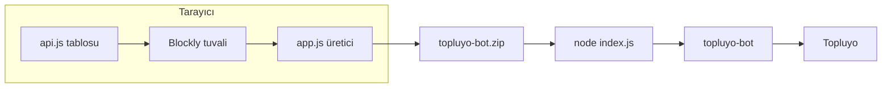
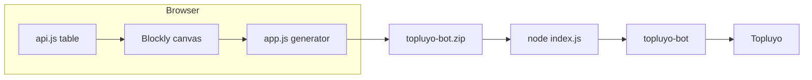

# Botluyo

[Türkçe](#türkçe) · [English](#english)

<p>
  
  
  
  
  
</p>

Kod yazmadan [Topluyo](https://topluyo.com) botu tasarlamanı sağlayan blok editörü. Blokları sürükle, sağda oluşan Node.js kodunu izle, hazır projeyi ZIP olarak indir.

Bot çalışınca [`topluyo-bot`](https://github.com/topluyo/TopluyoBOTJS) kütüphanesiyle Topluyo'ya bağlanır. Editörün kendisi bir sunucu değildir: tarayıcıda sadece kod üretir.

## Türkçe

### İçindekiler

- [Ne işe yarar](#ne-işe-yarar)
- [Hızlı başlangıç](#hızlı-başlangıç)
- [Arayüz](#arayüz)
- [Bloklar](#bloklar)
- [Üretilen kod](#üretilen-kod)
- [Çoklu dosya](#çoklu-dosya)
- [ZIP ile dışa aktarma](#zip-ile-dışa-aktarma)
- [Örnekler](#örnekler)
- [Token ve güvenlik](#token-ve-güvenlik)
- [Kayıt](#kayıt)
- [API listesinin tamamı](#api-listesinin-tamamı)
- [API tablosunu güncellemek](#api-tablosunu-güncellemek)
- [Sınırlar](#sınırlar)
- [Sorun giderme](#sorun-giderme)
- [Dosyalar](#dosyalar)
- [English](#english)

### Ne işe yarar

Botluyo, [Blockly 10.4.3](https://developers.google.com/blockly) üzerine kurulu bir Topluyo bot IDE'sidir. Araç kutusundaki her blok, `app.js` içindeki üreticiyle JavaScript'e çevrilir.

Yapabildikleri:

- Mesaj, mention, form, özel mesaj, Turbo transferi, gruba katılma, ayrılma ve atılma olaylarını dinlemek
- Bot bağlandığında bir kez çalışan bir şapka blok ve saniye cinsinden zamanlayıcı
- Olayın içinden kullanıcı, kanal, mesaj, grup, gönderi, form alanı ve Turbo alanlarını okumak
- [Topluyo API](https://topluyo.com/!api) yüzeyinin `api.js` içine alınmış **132 uç noktasını** blok olarak çağırmak
- Blockly'nin mantık, döngü, matematik, metin ve değişken bloklarını kullanmak
- Birden fazla `.js` dosyasına bölünmüş proje tutmak
- Sağ panelde, o an açık dosyanın kodunu canlı görmek
- Yanlış yere konmuş blokları, koda girmeden önce Blockly uyarısıyla göstermek
- `index.js`, ek modüller, `package.json`, `.token.json`, `.gitignore` ve kısa bir `README.md` içeren ZIP indirmek
- Çalışmanı bu tarayıcıda otomatik saklamak

Yapmadıkları:

- Botu tarayıcının içinde çalıştırmaz. Test için ZIP'i Node.js 18+ ile açman gerekir.
- Token'ı hiçbir sunucuya göndermez. Token yalnızca sen **Tokenli indir** dersen ZIP'teki `.token.json` dosyasına yazılır.
- `api.js` bir anlık görüntüdür. Topluyo yeni bir uç nokta eklerse, o blok kendiliğinden gelmez.



### Hızlı başlangıç

Editör için npm, derleme veya hesap gerekmez. Blockly dosyaları jsDelivr'den geldiği için sayfa açıkken internet gerekir.

```bash
git clone https://github.com/RID1-YILMAZ/Botluyo.git
cd Botluyo
```

`index.html` dosyasını tarayıcıda aç. İstersen küçük bir statik sunucu da kullanabilirsin:

```bash
python3 -m http.server 8080
```

Sonra `http://127.0.0.1:8080` adresine gir.

1. Soldaki **🎧 Dinle** kategorisinden bir olay bloğu çıkar.
2. İçine yapılacak işi tak. Boşta duran bloklar koda yazılmaz.
3. Sağdaki önizlemede uyarı ve kodu kontrol et.
4. **📦 Botu Hazırla** ile ZIP indir.
5. İndirdiğin projeyi çalıştır:

```bash
unzip topluyo-bot.zip -d botum
cd botum
npm install
npm start
```

`.token.json` düz bir JSON metnidir, nesne değildir:

```json
"BURAYA_TOKENINIZI_YAZIN"
```

Token'ı indirmeden önce girmek istersen penceredeki **🔑 Tokenli indir** düğmesini kullan.

Bot hesabının rumuzu `bot` ile **başlamalı ya da bitmelidir** (`botMuzo`, `MuzoBot`). Token, Topluyo'da **Cihazlarım** bölümünden alınır. Ayrıntı için [topluyo-bot](https://github.com/topluyo/TopluyoBOTJS) belgesine bak.

### Arayüz

Sayfa iki bölmedir. 900 pikselin altında alt alta iner, tuval yüksekliği ekranın yaklaşık üçte ikisi olur.

| Bölge | Ne var |
|---|---|
| Üst şerit | `🤖 Botluyo` başlığı |
| Dosya sekmeleri | `index.js` ve eklediğin modüller, **＋ Dosya**, `index.js` dışında **🗑️** |
| Tuval | Izgara, yakınlaştırma, çöp kutusu, tekerlekle zoom. Başlangıç ölçeği 0.9 |
| **📦 Botu Hazırla** | İndirme penceresini açar |
| Dosya ağacı | Açık dosyayı seçer. `package.json`, `.token.json`, `.gitignore` ve dışa aktarılan `README.md` ağaçta görünür ama düzenlenemez |
| Kod önizleme | Yalnızca seçili dosyanın üretilmiş kaynağı |

İndirme penceresi:

- **💾 Derlenmiş dosyaları indir (.zip)** — token yer tutucusuyla iner
- Token alanı — `type="password"`, tarayıcıya kaydettirilmez
- **🔑 Tokenli indir** — alan boşsa indirmez, kısa bir uyarı gösterir
- Kapat

### Bloklar

Bir **şapka** (olay, bağlanma veya zamanlayıcı) yeni bir dinleyici açar. Gövdesine takılan bloklar o dinleyicinin içine yazılır. Şapkanın dışında kalan hiçbir blok üretilen dosyaya girmez; üzerinde şu uyarı görünür:

> Bu blok bir olay bloğunun içinde değil, koda eklenmez.

Gelen-veri blokları yanlış olayın içindeyse üretici yine de ifadeyi yazar, ama blok uyarı verir. Örneğin kanal kimliği yalnızca mesaj ve mention olaylarında vardır.

#### Dinle

Hepsi turuncu şapkadır. Mesaj türevi olaylar `bot.on('message', ...)` dinler ve `data.action` ile süzülür. Alan adları [topluyo-bot olay tablosundan](https://github.com/topluyo/TopluyoBOTJS) alınmıştır.

| Blok | Üretilen dinleyici | Olayda gelenler |
|---|---|---|
| 📨 Mesaj gelince | `data.action === 'post/add'` | `message`, `channel_id`, `user_id` |
| 🔔 Mention (bildirim) gelince | `data.action === 'post/mention'` | `message`, `channel_id`, `user_id` |
| 📋 Form gönderilince | `data.action === 'post/bumote'` | `message.form`, `message.submit`, `post_id`, `user_id` |
| 💬 Özel mesaj gelince | `data.action === 'message/send'` | `message`, `user_id` |
| 💸 Turbo transferi gelince | `data.action === 'turbo/transfer'` | `message.quantity`, `message.message`, `transfer_id`, `user_id` |
| ➕ Gruba biri katılınca | `data.action === 'group/join'` | `group_id`, `user_id` |
| ➖ Gruptan biri ayrılınca | `data.action === 'group/leave'` | `group_id`, `user_id` |
| 🚪 Gruptan biri atılınca | `data.action === 'group/kick'` | `group_id`, `user_id` |
| 🟢 Bot bağlanınca | `bot.on('connected', ...)` | `data` yok |
| ⏰ Her N saniyede bir | `setInterval(..., N * 1000)` | `data` yok. Süre en az 1 saniye, blok üzerindeki sayı alanındadır |

Aynı ada sahip bir API yolu, dinleyiciyle aynı şey değildir.

- **Form gönderilince** gelen bir olayı dinler. Araç kutusundaki **Gönderi → Bumote ekle** ise `/!api/post/bumote` çağırır.
- **Özel mesaj gelince** gelen mesajı yakalar. **Özel mesaj → Özel mesaj gönder** ise `/!api/message/send` çağırır.
- **Gruptan biri atılınca** bir atılmayı haber verir. Birini sen atmak için **Üye → Üyeyi gruptan at** (`/!api/member/kick`) kullanırsın.

Her şapkanın gövdesi kendi `try/catch` bloğuna sarılır. Hata konsola `Blok hatası:` diye düşer, süreç ayakta kalır.

`index.js` şablonunun içinde, senin bloklarından bağımsız ikinci bir `connected` dinleyicisi de vardır. O sadece `Bot bağlandı ✅` yazar. Kendin de **Bot bağlanınca** eklersen ikisi birden çalışır.

#### Gelen veri

Bu bloklar değer üretir, kendi başlarına bir satır değildir. Yalnızca tablodaki olayların şapkasına takıldıklarında uyarı vermezler.

| Blok | Kod | Geçerli olduğu olaylar |
|---|---|---|
| 👤 Kullanıcı ID (olayı yapan) | `data.user_id` | Sekiz mesaj olayının hepsi |
| 📺 Kanal ID | `data.channel_id` | Mesaj, mention |
| 💬 Mesaj metni | `data.message` | Mesaj, mention, özel mesaj |
| 👥 Grup ID | `data.group_id` | Katılma, ayrılma, atılma |
| 🧾 Gönderi ID | `data.post_id` | Form |
| 🔘 Form buton etiketi | `data.message.submit` | Form |
| 📋 Form alanı | `data.message.form[alan]` | Form |
| 💰 Turbo miktarı | `data.message.quantity` | Turbo transferi |
| 📝 Turbo notu | `data.message.message` | Turbo transferi |
| 🔢 Transfer ID | `data.transfer_id` | Turbo transferi |

Form alanı bir değer yuvası ister. İçine bir metin bloğuyla alanın adını yazarsın (`ad`, `yas`). Üretilen ifade `data.message.form['ad']` biçimindedir.

Bağlanma ve zamanlayıcı şapkalarında `data` yoktur. Bu değer bloklarını oraya takma.

#### API

**🌐 API (tüm özellikler)** kategorisi `api.js` okunurken kurulur. 21 grup, 132 blok. Grup adı ve Blockly renk tonu dosyadaki `## Grup|ton` satırından gelir.

Her API bloğu bir satırdır ve yanıtı `_son` değişkenine bırakır:

```js
_son = await bot.post("/!api/post/add", { channel_id: data.channel_id, text: 'Merhaba' });
```

Alan kuralları, üreticide birebir böyledir:

- Boş bırakılan veya boş metne denk gelen alan gövdeye **yazılmaz**.
- `api.js` içinde `#` ile işaretli alanlar sayıdır. Değeri `'42'` gibi düz bir sayı metniyse tırnaklar kalkar ve `42` olur.
- Değişken, `data.user_id` veya bir hesap ifadesi olduğu gibi kalır. Sayı alanı diye zorla sayıya çevrilmez.
- Üçten az veya eşit alanlı bloklar yatay, daha kalabalık bloklar alt alta dizilir.
- İstekler `bot.post` ile gider. `topluyo-bot` bu çağrıları hız sınırına takılmamak için kendi içinde toplu gönderir.

Son yanıtı okumak için **🧰 Yardımcı** kategorisindeki iki blok vardır:

| Blok | Kod |
|---|---|
| 📦 Son API yanıtı | `_son` |
| 📦 Son yanıtın … alanı | `_son ? _son[alan] : undefined` |

`_son` dosya başına tektir. Aynı dosyada her başarılı API çağrısı bir öncekini ezer. Başka bir dosyanın `_son` değeri görünmez.

Uç noktaların tam listesi [aşağıda](#api-listesinin-tamamı).

#### Mantık, döngü, matematik

Blockly'nin kendi bloklarıdır. Türkçe arayüz `msg/tr.js` ile gelir.

| Kategori | Bloklar |
|---|---|
| 🔀 Mantık | eğer, karşılaştırma, ve/veya, değil, doğru/yanlış |
| 🔁 Döngü | tekrarla, şu koşul sağlandıkça, döngüyü kes / devam et |
| 🔢 Matematik | sayı, dört işlem, iki sayı arasında rastgele tam sayı, mod |

Karşılaştırma operatörü Blockly'nin ürettiği JavaScript'tir (`==`, `>`, `>=` ve benzeri). `Eğer` bir şapkanın veya başka bir `eğer`in içine takılır.

Döngüler olayın `async` fonksiyonunun içinde çalışır. Bitmeyen bir `şöyle iken` döngüsü o olayı kilitler. Beklemeli tekrar için **Bekle** bloğunu kullan.

#### Metin

| Blok | Ne üretir |
|---|---|
| Metin, birleştir, uzunluk | Blockly'nin metin blokları |
| … şununla başlıyor mu | `String(a).startsWith(b)` |
| … içinde geçiyor mu | `String(a).includes(b)` |
| … metninin N. kelimesi | Boşluklardan böl, 1'den say. Yoksa `''` |

Kelime sayacı 1 tabanlıdır. `!ban Ali` metninin 2. kelimesi `Ali` olur.

#### Değişkenler

**📦 Değişkenler** Blockly'nin standart değişken kategorisidir. Adı sen koyarsın. Değişken, tanımlandığı dosyanın ve içinde bulunduğu fonksiyonun kapsamında kalır. `yardim.js` içindeki değişken `index.js` tarafından görülmez.

Üretici `data`, `bot`, `TOKEN`, `TopluyoBOT`, `err`, `require`, `console` ve `_son` adlarını ayırır. Değişkenine bu adları verme.

#### Yardımcı

| Blok | Kod |
|---|---|
| 🖨️ Konsola yaz | `console.log(...)` |
| ⏱️ Bekle | `await new Promise(r => setTimeout(r, (saniye) * 1000))` |

Bekle saniye cinsindendir. Zamanlayıcı şapkası da saniye alır, ama o bir kezlik bekleme değil, kendini tekrar eden `setInterval`'dır. Aralık süreç kapanana kadar sürer, silinmez.

### Üretilen kod

`index.js` her zaman şu iskeletle başlar. Altına, tuvaldeki şapkaların kodu eklenir. Ek dosyalar `require` ile, şapkalardan **önce** yüklenir.

```js
// index.js — Botluyo ile oluşturuldu
const TopluyoBOT = require('topluyo-bot');
const TOKEN = require('./.token.json');
const bot = TopluyoBOT(TOKEN);
let _son;

bot.on('connected', () => console.log('Bot bağlandı ✅'));
bot.on('auth_problem', () => console.error('Token geçersiz! "Cihazlarım" bölümünden yenisini alın.'));
bot.on('error', (err) => console.error('Hata:', err));

require('./yardim.js')(bot);

// ... şapka bloklarının kodu
```

Mesaj türevi bir şapka şöyle iner:

```js
bot.on('message', async (data) => {
  if (data.action === 'post/add') {
    try {
      // gövde, iki seviye içeride
    } catch (err) {
      console.error('Blok hatası:', err);
    }
  }
});
```

Bağlanma:

```js
bot.on('connected', async () => {
  try {
    // gövde
  } catch (err) {
    console.error('Blok hatası:', err);
  }
});
```

Zamanlayıcı, alan 60 ise:

```js
setInterval(async () => {
  try {
    // gövde
  } catch (err) {
    console.error('Blok hatası:', err);
  }
}, 60000);
```

`auth_problem` gelirse kütüphane yeniden bağlanmaz. Token'ı Cihazlarım'dan yenilemen gerekir. `error` bir soket hatasıdır. Bağlantı kopunca yeniden deneme `topluyo-bot`'un kendi işidir.

### Çoklu dosya

Projede her zaman bir `index.js` vardır. Silinemez.

**＋ Dosya** bir ad sorar. Ad küçük harfe çevrilir, Türkçe karakterler sadeleşir (`çğıöşü` → `cgiosu`), `.js` uzantısı sen yazsan da bir kez eklenir. `index.js` ve kullanılmakta olan bir ad reddedilir.

`yardim-menusu.js` şöyle dışa aktarılır:

```js
// yardim-menusu.js — Botluyo ile oluşturuldu
module.exports = (bot) => {
  let _son;
  // bu dosyanın şapkaları
};
```

Dosyalar birbirinin değişkenini ve `_son` değerini görmez. Ortak olan tek nesne `bot`'tur. Ortak bir bellek istersen Topluyo'daki **Park** uçlarını (`park/set`, `park/list`, `park/del`) veya tek dosyada kalmayı tercih et.

Sekmeler arasında geçerken açık tuval Blockly serileştirmesiyle saklanır, diğeri geri yüklenir.

### ZIP ile dışa aktarma

ZIP tarayıcıda kurulur. Harici bir sıkıştırma kütüphanesi yoktur. Dosyalar sıkıştırmasız (store) yazılır, UTF-8 adları ve CRC32 vardır.

| Dosya | İçerik |
|---|---|
| `index.js` | Şablon + senin şapkaların |
| `*.js` | Varsa diğer modüller |
| `package.json` | `name`: `topluyo-bot-projesi`, `start`: `node index.js`, `engines.node`: `>=18`, bağımlılık `topluyo-bot` sürümü `latest` |
| `.token.json` | Girdiğin token ya da `"BURAYA_TOKENINIZI_YAZIN"` |
| `.gitignore` | `.token.json` ve `node_modules/` |
| `README.md` | Üç satırlık çalıştırma notu. Bu deponun belgesi değil |

İndirilen arşivin adı her zaman `topluyo-bot.zip` olur.

`topluyo-bot` sürümü sabitlenmez. `npm install` o anki son sürümü alır. Yayınladığın bir botu kilitlemek istersen indirdikten sonra `package.json` içine gördüğün sürümü yaz.

### Örnekler

Aşağıdaki kaynaklar, ilgili bloklar takıldığında üreticinin çıkardığı biçimdedir. Önizleme paneli senin tuvalin için tam metni gösterir.

#### `!merhaba` yanıtı

1. **📨 Mesaj gelince**
2. İçine **eğer**: mesaj metni `==` `!merhaba`
3. Eğerin içine **Gönderi → Gönderi gönder**: kanal yuvasına **📺 Kanal ID**, `text` yuvasına `Merhaba!`

```js
bot.on('message', async (data) => {
  if (data.action === 'post/add') {
    try {
      if (data.message == '!merhaba') {
        _son = await bot.post("/!api/post/add", { channel_id: data.channel_id, text: 'Merhaba!' });
      }
    } catch (err) {
      console.error('Blok hatası:', err);
    }
  }
});
```

#### Mention'a cevap

**🔔 Mention (bildirim) gelince** içine, kanal kimliğiyle bir gönderi koy. Mention metninde bir kelime arayacaksan **içinde geçiyor mu** bloğunu eğer koşuluna tak.

#### Komutun ikinci kelimesi

Mesaj dinleyicisinin içinde:

- eğer: mesaj `şununla başlıyor mu` `!selam`
- konsola yaz: mesajın `2`. kelimesi

`!selam Ada` için konsola `Ada` düşer.

```js
if (String(data.message).startsWith('!selam')) {
  console.log((String(data.message).trim().split(/\s+/)[(2) - 1] ?? ''));
}
```

#### Turbo gelince teşekkür

**💸 Turbo transferi gelince** → eğer miktar `>=` `10` → **Turbo → Turbo gönder**:

- kullanıcı: **👤 Kullanıcı ID**
- miktar: `1`
- mesaj: `Teşekkürler!`

Miktar `#` ile işaretli olduğu için düz sayı tırnaksız yazılır. Kullanıcı kimliği bir veri bloğu olduğu için ifade olarak kalır.

```js
bot.on('message', async (data) => {
  if (data.action === 'turbo/transfer') {
    try {
      if (data.message.quantity >= 10) {
        _son = await bot.post("/!api/turbo/transfer", { user_id: data.user_id, quantity: 1, message: 'Teşekkürler!' });
      }
    } catch (err) {
      console.error('Blok hatası:', err);
    }
  }
});
```

#### Gruba katılana duyuru

Katılma olayında kanal kimliği gelmez. **Gönderi gönder** bloğunun kanal alanına kendi kanal numaranı yaz.

```js
bot.on('message', async (data) => {
  if (data.action === 'group/join') {
    try {
      _son = await bot.post("/!api/post/add", { channel_id: 12345, text: 'Hoş geldin' });
    } catch (err) {
      console.error('Blok hatası:', err);
    }
  }
});
```

#### Form alanı

**📋 Form gönderilince** içine **Form alanı** tak, alan adına formda kullandığın anahtarı yaz. Butonun yazısı **🔘 Form buton etiketi**dir (`data.message.submit`).

```js
console.log(data.message.form['ad']);
console.log(data.message.submit);
```

#### Son API yanıtını kullanmak

**Test → Sunucu saatini getir** bloğunun hemen altına **🖨️ Konsola yaz**, içine **📦 Son API yanıtı**.

```js
_son = await bot.post("/!api/test/time", {});
console.log(_son);
```

Alanı yoksa gövde boş nesnedir `{}`. Belirli bir alanı istiyorsan **Son yanıtın … alanı** bloğuna alanın adını yaz.

#### Dakikada bir

**⏰ Her 60 saniyede bir** şapkasının içine aynı saat çağrısını koy. Bu bir `message` dinleyicisi değildir, `data` kullanma.

### Token ve güvenlik

- Token bir cihaz anahtarıdır. Sohbete, ekran görüntüsüne, issue'ya yapıştırma.
- Repodaki ve ZIP'teki `.gitignore`, `.token.json` dosyasını dışlar. Yine de `git status` ile sızmadığını kontrol et.
- **Tokenli indir**, token'ı yalnız o ZIP'e yazar. Ağ isteği atmaz, `localStorage`'a token koymaz.
- Token penceresindeki alan parola kutusudur. İndirme bitince temizlenir.
- Sızdıysa Cihazlarım'dan yenile. Eski anahtar `auth_problem` ile düşer.
- Üretilen bot, token'ın sahibinin yetkisiyle `/!api` çağırır. Silme, atma, Turbo gönderme blokları gerçek işlemdir.

### Kayıt

Tuval her değişimden yaklaşık 200 ms sonra `localStorage` anahtarı `botluyo-v2` altına yazılır. Kayıt, dosya listesini, seçili dosyayı ve Blockly çalışma alanının serileştirilmiş halini tutar.

- Yalnızca bu tarayıcı, bu köken. `file://` ile `http://127.0.0.1` ayrı depolardır.
- Başka bilgisayara taşımak için ZIP indirmen gerekir. Ayrı bir proje JSON'u içe/dışa aktarma düğmesi yoktur.
- Depolama dolarsa kayıt sessizce başarısız olur. Kod önizlemen durmaz, ama sayfayı yenileyince tuval eski kalabilir.
- Eski bir kayıtta `index.js` yoksa yok sayılır.

### API listesinin tamamı

Kaynak `api.js`. Biçim: `#alan` sayı, işaretsiz alan metin veya serbest değer. Boş alanlar çağrıya girmez. Grupları açmak için başlığa tıkla. Blok adları araç kutusundaki Türkçe yazılardır.

**Summary:**
<b>Şikayet</b> — 1 uç nokta

| Uç nokta | Bloktaki ad | Alanlar |
|---|---|---|
| `/!api/abuse/market` | Market uygulamasını şikayet et | `app_id` *(sayı)*, `reason_text` |

**Summary:**
<b>Rozet</b> — 4 uç nokta

| Uç nokta | Bloktaki ad | Alanlar |
|---|---|---|
| `/!api/badge/add` | Rozet ekle | `group_id` *(sayı)*, `name`, `nick`, `description`, `image`, `level` |
| `/!api/badge/all` | Tüm rozetleri getir | — |
| `/!api/badge/give` | Rozet ver | `badge_id` *(sayı)*, `user_id` *(sayı)* |
| `/!api/badge/list` | Grup rozetlerini listele | `group_id` *(sayı)*, `group_nick` |

**Summary:**
<b>Kanal</b> — 10 uç nokta

| Uç nokta | Bloktaki ad | Alanlar |
|---|---|---|
| `/!api/channel/add` | Kanal oluştur | `group_id` *(sayı)*, `nick`, `title`, `description`, `type` *(sayı)*, `data`, `read_role_ids`, `write_role_ids`, `control_role_ids`, `read_plus_user_ids`, `read_minus_user_ids`, `write_plus_user_ids`, `write_minus_user_ids`, `control_plus_user_ids`, `control_minus_user_ids` |
| `/!api/channel/del` | Kanalı sil | `channel_id` *(sayı)* |
| `/!api/channel/detail` | Kanal kullanıcı izinlerini getir | `channel_id` *(sayı)* |
| `/!api/channel/get` | Kanal bilgisini getir | `channel_id` *(sayı)* |
| `/!api/channel/list` | Gruptaki kanalları listele | `group_id` *(sayı)* |
| `/!api/channel/options/set` | Kanal seçeneklerini değiştir | `channel_id` *(sayı)*, `add_read_plus_user_id` *(sayı)*, `del_read_plus_user_id` *(sayı)*, `add_read_minus_user_id` *(sayı)*, `del_read_minus_user_id` *(sayı)*, `add_write_plus_user_id` *(sayı)*, `del_write_plus_user_id` *(sayı)*, `add_write_minus_user_id` *(sayı)*, `del_write_minus_user_id` *(sayı)*, `add_control_plus_user_id` *(sayı)*, `del_control_plus_user_id` *(sayı)*, `add_control_minus_user_id` *(sayı)*, `del_control_minus_user_id` *(sayı)* |
| `/!api/channel/set` | Kanalı düzenle | `channel_id` *(sayı)*, `nick`, `title`, `description`, `type` *(sayı)*, `data`, `read_role_ids`, `write_role_ids`, `control_role_ids`, `read_plus_user_ids`, `read_minus_user_ids`, `write_plus_user_ids`, `write_minus_user_ids`, `control_plus_user_ids`, `control_minus_user_ids` |
| `/!api/channel/show` | Kanalı göster | `group_nick`, `channel_nick` |
| `/!api/channel/show/info` | Kanal bilgisini göster | `channel_id` *(sayı)*, `group_nick`, `channel_nick` |
| `/!api/channel/sort` | Kanalları sırala | `group_id` *(sayı)*, `channel_ids` |

**Summary:**
<b>Ekip</b> — 8 uç nokta

| Uç nokta | Bloktaki ad | Alanlar |
|---|---|---|
| `/!api/crew/add` | Ekip oluştur | `group_id` *(sayı)*, `name`, `color`, `image` |
| `/!api/crew/del` | Ekibi sil | `crew_id` *(sayı)* |
| `/!api/crew/get` | Ekibi getir | `crew_id` *(sayı)* |
| `/!api/crew/join` | Ekibe katıl | `crew_id` *(sayı)* |
| `/!api/crew/leave` | Ekipten ayrıl | `crew_id` *(sayı)* |
| `/!api/crew/list` | Ekipleri listele | `group_id` *(sayı)* |
| `/!api/crew/set` | Ekibi düzenle | `crew_id` *(sayı)*, `name`, `color`, `image` |
| `/!api/crew/sort` | Ekipleri sırala | `group_id` *(sayı)*, `crew_ids` |

**Summary:**
<b>Favori</b> — 2 uç nokta

| Uç nokta | Bloktaki ad | Alanlar |
|---|---|---|
| `/!api/favorite/list` | Favori kanalları listele | — |
| `/!api/favorite/toggle` | Kanalı favoriye ekle/çıkar | `channel_id` *(sayı)* |

**Summary:**
<b>Arkadaş</b> — 3 uç nokta

| Uç nokta | Bloktaki ad | Alanlar |
|---|---|---|
| `/!api/friend/add` | Arkadaş ekle / isteği kabul et | `user_id` *(sayı)* |
| `/!api/friend/del` | Arkadaşı sil | `user_id` *(sayı)* |
| `/!api/friend/status` | Arkadaşlık durumu | `user_id` *(sayı)* |

**Summary:**
<b>Grup</b> — 16 uç nokta

| Uç nokta | Bloktaki ad | Alanlar |
|---|---|---|
| `/!api/group/add` | Grup oluştur | `name`, `description` |
| `/!api/group/del` | Grubu sil | `group_id` *(sayı)* |
| `/!api/group/founder` | Grup kurucusunu getir | `group_id` *(sayı)* |
| `/!api/group/get` | Grup bilgisini getir | `id` *(sayı)*, `nick` |
| `/!api/group/join` | Gruba katılma isteği gönder | `group_id` *(sayı)* |
| `/!api/group/joinlist` | Katılma isteklerini listele | `group_id` *(sayı)* |
| `/!api/group/leave` | Gruptan ayrıl | `group_id` *(sayı)* |
| `/!api/group/list` | Gruplarımı listele | — |
| `/!api/group/online` | Çevrimiçi üyeleri getir | `group_id` *(sayı)* |
| `/!api/group/popular` | Popüler grupları getir | — |
| `/!api/group/set` | Grubu düzenle | — |
| `/!api/group/set/home` | Grup ana sayfasını değiştir | `group_id` *(sayı)*, `home` |
| `/!api/group/set/permissions` | Grup izinlerini ayarla | `group_id` *(sayı)*, `discover_me` *(sayı)*, `everyone_member` *(sayı)*, `abuse_filter` *(sayı)*, `enable_ads` *(sayı)* |
| `/!api/group/set/profile` | Grup profilini ayarla | `group_id` *(sayı)*, `name`, `image`, `description` |
| `/!api/group/set/socials` | Grup sosyal hesaplarını ayarla | `social_instagram`, `social_x`, `social_youtube`, `social_tiktok`, `social_kick`, `social_twitch`, `social_github`, `social_steam`, `social_linkedin`, `social_website` |
| `/!api/group/sort` | Grupları sırala | `group_ids` |

**Summary:**
<b>Market</b> — 18 uç nokta

| Uç nokta | Bloktaki ad | Alanlar |
|---|---|---|
| `/!api/market/api/get` | Uygulama anahtarını getir | `app_id` *(sayı)* |
| `/!api/market/api/reset` | Uygulama anahtarını sıfırla | — |
| `/!api/market/add` | Uygulama oluştur | `name`, `app_type_id` *(sayı)*, `description` |
| `/!api/market/app/install` | Uygulamayı gruba yükle | `app_id` *(sayı)*, `group_id` *(sayı)* |
| `/!api/market/comment/add` | Uygulamaya yorum ekle | `app_id` *(sayı)*, `rate` *(sayı)*, `text` |
| `/!api/market/comment/list` | Uygulama yorumlarını listele | `app_id` *(sayı)* |
| `/!api/market/get` | Uygulamayı getir | `app_id` *(sayı)* |
| `/!api/market/hide` | Uygulamayı gizle/sil | `app_id` *(sayı)* |
| `/!api/market/library/add` | Kütüphaneye ekle | `app_id` *(sayı)* |
| `/!api/market/library/del` | Kütüphaneden çıkar | `app_id` *(sayı)* |
| `/!api/market/library/list` | Kütüphanemi listele | — |
| `/!api/market/list` | Market'i listele | `app_type_ids`, `publisher_id` *(sayı)*, `search`, `verified` *(sayı)*, `limit` *(sayı)* |
| `/!api/market/myapps` | Uygulamalarımı getir | — |
| `/!api/market/publisher/get` | Yayıncıyı getir | `publisher_id` *(sayı)* |
| `/!api/market/revision/get` | Son revizyonu getir | `app_id` *(sayı)* |
| `/!api/market/revision/publish` | Revizyonu yayınla | `app_id` *(sayı)* |
| `/!api/market/revision/set/content` | Revizyon içeriğini ayarla | `app_id` *(sayı)*, `name`, `description`, `image`, `icon` |
| `/!api/market/revision/set/detail` | Revizyon ayrıntısını ayarla | `app_id` *(sayı)*, `link`, `css`, `webhook`, `app_type_id` *(sayı)* |

**Summary:**
<b>Üye</b> — 7 uç nokta

| Uç nokta | Bloktaki ad | Alanlar |
|---|---|---|
| `/!api/member/get` | Üyeyi getir | `group_id` *(sayı)*, `user_id` *(sayı)*, `user_nick` |
| `/!api/member/info` | Üyelik bilgimi getir | `group_id` *(sayı)* |
| `/!api/member/kick` | Üyeyi gruptan at | `group_id` *(sayı)*, `user_id` *(sayı)* |
| `/!api/member/list` | Üyeleri listele | `group_id` *(sayı)* |
| `/!api/member/role/set` | Üyenin rollerini ayarla | `group_id` *(sayı)*, `user_id` *(sayı)*, `role_ids` |
| `/!api/member/waiter/accept` | Katılma isteğini kabul et | `group_id` *(sayı)*, `user_id` *(sayı)* |
| `/!api/member/waiter/reject` | Katılma isteğini reddet | `group_id` *(sayı)*, `user_id` *(sayı)* |

**Summary:**
<b>Özel mesaj</b> — 5 uç nokta

| Uç nokta | Bloktaki ad | Alanlar |
|---|---|---|
| `/!api/message/get` | Mesajları getir | `user_id` *(sayı)* |
| `/!api/message/get/user` | Kullanıcıdan mesajları getir | `user_id` *(sayı)* |
| `/!api/message/list/user` | Mesajlaştığım kullanıcıları listele | — |
| `/!api/message/read` | Mesajları okundu yap | `user_id` *(sayı)* |
| `/!api/message/send` | Özel mesaj gönder | `user_id` *(sayı)*, `message` |

**Summary:**
<b>Bildirim</b> — 5 uç nokta

| Uç nokta | Bloktaki ad | Alanlar |
|---|---|---|
| `/!api/notification/get/push/key` | Push anahtarını getir | — |
| `/!api/notification/list` | Bildirimleri listele | — |
| `/!api/notification/read` | Bildirimi okundu yap | `id` *(sayı)* |
| `/!api/notification/read/all` | Tüm bildirimleri okundu yap | `type` *(sayı)* |
| `/!api/notification/set/push/endpoint` | Push uç noktasını ayarla | `endpoint` |

**Summary:**
<b>Park</b> — 3 uç nokta

| Uç nokta | Bloktaki ad | Alanlar |
|---|---|---|
| `/!api/park/del` | Park verisini sil | `channel_id` *(sayı)*, `key` |
| `/!api/park/list` | Park verilerini listele | `channel_id` *(sayı)*, `key` |
| `/!api/park/set` | Park verisi kaydet | `channel_id` *(sayı)*, `key`, `val` |

**Summary:**
<b>Pass</b> — 2 uç nokta

| Uç nokta | Bloktaki ad | Alanlar |
|---|---|---|
| `/!api/pass/get` | Geçiş kodu al | — |
| `/!api/pass/use` | Geçiş kodunu kullan | `pass_code` |

**Summary:**
<b>Yetki</b> — 2 uç nokta

| Uç nokta | Bloktaki ad | Alanlar |
|---|---|---|
| `/!api/permission/channel` | Kanal yetkisini getir | `channel_id` *(sayı)*, `user_id` *(sayı)* |
| `/!api/permission/power` | Grup gücünü getir | `group_id` *(sayı)*, `user_id` *(sayı)* |

**Summary:**
<b>Gönderi</b> — 6 uç nokta

| Uç nokta | Bloktaki ad | Alanlar |
|---|---|---|
| `/!api/post/add` | Gönderi gönder | `channel_id` *(sayı)*, `group_nick`, `channel_nick`, `code`, `text` |
| `/!api/post/bumote` | Bumote ekle | `post_id` *(sayı)*, `code` |
| `/!api/post/del` | Gönderiyi sil | `post_id` *(sayı)* |
| `/!api/post/get` | Gönderiyi getir | `post_id` *(sayı)* |
| `/!api/post/list` | Gönderileri listele | `channel_id` *(sayı)*, `group_nick`, `channel_nick`, `after` *(sayı)*, `before` *(sayı)* |
| `/!api/post/set` | Gönderiyi düzenle | `post_id` *(sayı)*, `channel_id` *(sayı)*, `code`, `text` |

**Summary:**
<b>Arama</b> — 2 uç nokta

| Uç nokta | Bloktaki ad | Alanlar |
|---|---|---|
| `/!api/public/search` | Kullanıcı/grup ara | `text` |
| `/!api/public/usernickavailable` | Kullanıcı adı müsait mi | `nick` |

**Summary:**
<b>Rol</b> — 6 uç nokta

| Uç nokta | Bloktaki ad | Alanlar |
|---|---|---|
| `/!api/role/add` | Rol oluştur | `group_id` *(sayı)*, `name`, `color`, `power_group` *(sayı)*, `power_role` *(sayı)*, `power_channel` *(sayı)*, `power_post` *(sayı)*, `power_member` *(sayı)*, `power_room` *(sayı)*, `power_team` *(sayı)*, `power_mention` *(sayı)* |
| `/!api/role/del` | Rolü sil | `role_id` *(sayı)* |
| `/!api/role/get` | Rolü getir | `role_id` *(sayı)* |
| `/!api/role/list` | Rolleri listele | `group_id` *(sayı)* |
| `/!api/role/set` | Rolü düzenle | `role_id` *(sayı)*, `name`, `color`, `power_group` *(sayı)*, `power_role` *(sayı)*, `power_channel` *(sayı)*, `power_post` *(sayı)*, `power_member` *(sayı)*, `power_room` *(sayı)*, `power_team` *(sayı)*, `power_mention` *(sayı)* |
| `/!api/role/sort` | Rolleri sırala | `group_id` *(sayı)*, `role_ids` |

**Summary:**
<b>Takım</b> — 1 uç nokta

| Uç nokta | Bloktaki ad | Alanlar |
|---|---|---|
| `/!api/team/list` | Takımları listele | `group_id` *(sayı)* |

**Summary:**
<b>Test</b> — 2 uç nokta

| Uç nokta | Bloktaki ad | Alanlar |
|---|---|---|
| `/!api/test/ip` | IP adresini getir | — |
| `/!api/test/time` | Sunucu saatini getir | — |

**Summary:**
<b>Turbo</b> — 2 uç nokta

| Uç nokta | Bloktaki ad | Alanlar |
|---|---|---|
| `/!api/turbo/history/list` | Turbo geçmişini getir | `limit` *(sayı)*, `offset` *(sayı)* |
| `/!api/turbo/transfer` | Turbo gönder | `user_id` *(sayı)*, `quantity` *(sayı)*, `message` |

**Summary:**
<b>Kullanıcı</b> — 27 uç nokta

| Uç nokta | Bloktaki ad | Alanlar |
|---|---|---|
| `/!api/user/2fa/get` | 2FA kodunu getir | — |
| `/!api/user/2fa/verify` | 2FA doğrula | `code` |
| `/!api/user/auth` | Giriş yap / kayıt ol | `email`, `pass` |
| `/!api/user/block` | Kullanıcıyı engelle | `user_id` *(sayı)* |
| `/!api/user/blocked/users` | Engellenenleri listele | — |
| `/!api/user/devices` | Cihazlarımı getir | — |
| `/!api/user/friends` | Arkadaşlarımı getir | — |
| `/!api/user/groups` | Sahibi olduğum grupları getir | `owner_id` *(sayı)* |
| `/!api/user/id` | Kullanıcı ID'mi getir | — |
| `/!api/user/info` | Kullanıcı bilgisi getir | `id` *(sayı)*, `nick` |
| `/!api/user/lang/set` | Dili ayarla | `lang` |
| `/!api/user/list` | Kullanıcıları listele | `user_ids` |
| `/!api/user/login` | Giriş yap | `email`, `pass` |
| `/!api/user/logout` | Çıkış yap | `token`, `other` |
| `/!api/user/notification/info` | Bildirim durumunu getir | — |
| `/!api/user/notification/set` | Bildirim türlerini ayarla | `mention` *(sayı)*, `friendship` *(sayı)*, `news` *(sayı)*, `turbo` *(sayı)*, `message` *(sayı)* |
| `/!api/user/pass` | Kod ile geç | `code` |
| `/!api/user/qr/get` | QR girişi getir | `private_key` |
| `/!api/user/qr/set` | QR ile giriş yap | `public_key` |
| `/!api/user/register` | Kayıt ol | `email`, `pass` |
| `/!api/user/register/verify` | Kaydı doğrula | `code` |
| `/!api/user/set/privacy` | Gizliliği ayarla | `everyone_call` *(sayı)*, `everyone_message` *(sayı)* |
| `/!api/user/set/profile` | Profili ayarla | `image`, `name`, `nick`, `about_me` |
| `/!api/user/set/slide` | Slayt ayarla | `app_id` *(sayı)* |
| `/!api/user/set/socials` | Sosyal hesapları ayarla | `social_instagram`, `social_x`, `social_youtube`, `social_tiktok`, `social_kick`, `social_twitch`, `social_github`, `social_steam`, `social_linkedin`, `social_website` |
| `/!api/user/unblock` | Engeli kaldır | `user_id` *(sayı)* |
| `/!api/user/waiting/list` | Bekleyenleri listele | — |

### API tablosunu güncellemek

`api.js` içindeki şablon dizeden başka bir yere uç nokta yazmana gerek yoktur. Sayfa açılışında `app.js` bu metni böler, her satır için bir Blockly bloğu ve bir üretici tanımlar.

```
## Grup adı|renk tonu
yol|Türkçe blok adı|alan1,#sayisalAlan,alan3
```

- `##` satırı yeni bir araç kutusu grubu açar. Renk, Blockly hue değeridir (0–360).
- Yol, `/!api/` önekine eklenir. Blok tipi `api_` + yolun `/` yerine `_` konmuş halidir.
- Alan listesi boş olabilir. Virgülle ayrılır, boşluk koyma.
- `#` yalnızca o alanın düz sayı yazıldığında tırnaksız basılması içindir.

Resmi liste [topluyo.com/!api](https://topluyo.com/!api) adresindedir. Bir yolu ekledikten veya sildikten sonra sayfayı yenile. Eski tuvalde duran, tipi silinmiş bir blok yüklenemeyebilir. Onu çöpe atman gerekir.

### Sınırlar

- Editör bot çalıştırmaz, WebSocket açmaz, Topluyo'ya giriş yapmaz.
- Blockly CDN'den gelir: `blockly_compressed.js`, `blocks_compressed.js`, `javascript_compressed.js`, `msg/tr.js` ve `media/` altındaki ikonlar. Sürüm sabittir: 10.4.3. Çevrimdışı açılırsa tuval boş kalır.
- Uyarı, veri bloğunu yanlış olayda kullanırsan kodu silmez. İfade yine de yazılır. Uyarıyı ciddiye al. Aksi halde `data.channel_id` gibi bir alan `undefined` olur.
- Şapkanın içindeki `try` bir JavaScript kapsamıdır. Orada açtığın `let` / Blockly değişkeni dışarı taşmaz.
- Dosyalar birbirini çağırmaz. Yalnızca `index.js`, diğerlerini `(bot)` argümanıyla yükler.
- Zamanlayıcı bir kez kurulur, `clearInterval` üretilmez.
- Aynı olayı iki şapkayla dinlersen iki ayrı `bot.on` olur. İkisi de çalışır.
- API listesi elle tutulur. Kütüphane veya site değişince `api.js` kendiliğinden güncellenmez.
- Dışa aktarılan `package.json`, `topluyo-bot` için `latest` der. Bu, yarın farklı bir sürüm kurabileceği anlamına gelir.
- Repoda bir `LICENSE` dosyası yoktur.

### Sorun giderme

| Belirti | Bakılacak yer |
|---|---|
| Tuval bomboş, araç kutusu yok | Ağ sekmesinde jsDelivr engelli mi? Sayfayı internet varken yenile |
| Blok sağdaki koda girmiyor | Bir şapkanın **içine** takılı değil. Uyarı metni bunu söyler |
| Değer bloğunda sarı uyarı | O alan bu olayda yok. Yukarıdaki gelen veri tablosuna bak |
| Konsolda `Token geçersiz!` | `.token.json` bir JSON **metni** olmalı: `"abc"`. Süslü parantezli nesne değil. Rumuz `bot` ile başlamıyor ve `bot` ile bitmiyorsa da giriş olmaz |
| `Cannot find module 'topluyo-bot'` | Proje klasöründe `npm install` çalışmamış |
| `npm start` hemen düşüyor | Node 18 altı. `node -v` |
| Bot bağlandı ama cevap yok | Olay adı yanlış şapkada olabilir. `!merhaba` bir **mesaj** olayıdır, mention değil. Kanal kimliğini elle yazdıysan sayı olduğundan emin ol |
| Turbo gitmiyor | Miktar sayı alanıdır. Metin bloğuna `1` yazmak da çalışır, çünkü `#` alanı düz sayının tırnağını söker. Değişkense değişkenin gerçekten sayı olması gerekir |
| Sayfayı yenileyince tuval gitti | Başka köken (`file` ve `localhost` karışması) veya depolama doluluğu. ZIP hâlâ elindeyse kaynak kod duruyordur. Tuval düzeni ZIP'e yazılmaz |
| Ek dosya `index.js` içinde yok | Dosya adı `index.js` değilse `require('./dosya.js')(bot)` satırı şablonun require bölgesine eklenir. Önizlemede `index.js` sekmesine geç |

### Dosyalar

```
.
├── index.html    # iskelet, Blockly 10.4.3 CDN, indirme penceresi
├── style.css     # düzen, mor başlık, dar ekran kırılımı
├── app.js        # blok tanımları, üretici, sekmeler, önizleme, ZIP
├── api.js        # 21 grup, 132 uç nokta
├── .gitignore    # .token.json, node_modules, log, .DS_Store
└── README.md
```

Editörün bağımlılığı bir paket dosyasında değildir. Çalıştırılan botun bağımlılığı, indirdiğin ZIP'in `package.json` dosyasındadır.

### Bağlantılar

- Site: [topluyo.com](https://topluyo.com)
- Bot kütüphanesi: [topluyo/TopluyoBOTJS](https://github.com/topluyo/TopluyoBOTJS) (`npm install topluyo-bot`)
- HTTP API: [topluyo.com/!api](https://topluyo.com/!api)
- Blockly: [developers.google.com/blockly](https://developers.google.com/blockly)

---

## English

[Türkçe](#türkçe) · [English](#english)

A block editor for designing a [Topluyo](https://topluyo.com) bot without writing code by hand. Drag blocks, watch the Node.js source appear on the right, then download a ready-to-run project ZIP.

When the bot runs, it connects through the [`topluyo-bot`](https://github.com/topluyo/TopluyoBOTJS) library. The editor itself is not a server. The browser only generates code.

### Contents

- [What it does](#what-it-does)
- [Quick start](#quick-start)
- [Interface](#interface)
- [Blocks](#blocks)
- [Generated code](#generated-code)
- [Multiple files](#multiple-files)
- [ZIP export](#zip-export)
- [Examples](#examples-1)
- [Token and safety](#token-and-safety)
- [Saving](#saving)
- [Full API list](#full-api-list)
- [Updating the API table](#updating-the-api-table)
- [Limits](#limits)
- [Troubleshooting](#troubleshooting)
- [Files](#files)

### What it does

Botluyo is a Topluyo bot IDE built on [Blockly 10.4.3](https://developers.google.com/blockly). Every toolbox block is turned into JavaScript by the generator in `app.js`.

It can:

- Listen for a message, mention, form submit, private message, Turbo transfer, and group join, leave, or kick
- Run a hat block once when the bot connects, and a timer in seconds
- Read the user, channel, message, group, post, form field, and Turbo fields from the event
- Call the **132 endpoints** of the [Topluyo API](https://topluyo.com/!api) that are snapshotted in `api.js`
- Use Blockly's logic, loop, math, text, and variable blocks
- Keep a project split across several `.js` files
- Show the open file's source live in the side panel
- Warn, before code generation, when a block is in the wrong place
- Download a ZIP with `index.js`, extra modules, `package.json`, `.token.json`, `.gitignore`, and a short `README.md`
- Autosave the workspace in this browser

It does not:

- Run the bot in the browser. Unzip the project and run it with Node.js 18+.
- Send the token anywhere. The token is written into `.token.json` only if you choose **Tokenli indir**.
- Stay in sync by itself. `api.js` is a snapshot. A new Topluyo endpoint does not appear until you add it.



### Quick start

The editor needs no npm install, no build, and no account. Blockly is loaded from jsDelivr, so the page needs a network while it is open.

```bash
git clone https://github.com/RID1-YILMAZ/Botluyo.git
cd Botluyo
```

Open `index.html` in a browser. A tiny static server also works:

```bash
python3 -m http.server 8080
```

Then open `http://127.0.0.1:8080`.

1. Pull an event block from **🎧 Dinle**.
2. Snap the work inside it. Blocks left loose are not written into the file.
3. Check warnings and source in the preview.
4. Download the ZIP with **📦 Botu Hazırla**.
5. Run the project:

```bash
unzip topluyo-bot.zip -d my-bot
cd my-bot
npm install
npm start
```

`.token.json` is a JSON string, not an object:

```json
"PUT_YOUR_TOKEN_HERE"
```

To bake the token in before download, use **🔑 Tokenli indir** in the dialog.

The bot account nick must **start or end** with `bot` (`botMuzo`, `MuzoBot`). Create the token under **Cihazlarım** on Topluyo. See [topluyo-bot](https://github.com/topluyo/TopluyoBOTJS) for the library contract.

### Interface

The page is two panes. Below 900px they stack, and the canvas is about two thirds of the screen.

| Area | What is there |
|---|---|
| Header | The `🤖 Botluyo` title |
| File tabs | `index.js`, your modules, **＋ Dosya**, and **🗑️** on every file except `index.js` |
| Canvas | Grid, zoom controls, trashcan, wheel zoom. Start scale 0.9 |
| **📦 Botu Hazırla** | Opens the download dialog |
| File tree | Switches the open file. `package.json`, `.token.json`, `.gitignore`, and the exported `README.md` are listed but not editable |
| Code preview | Generated source of the selected file only |

Download dialog:

- **💾 Derlenmiş dosyaları indir (.zip)** — downloads with a token placeholder
- Token field — `type="password"`, not stored by the browser autocomplete hint
- **🔑 Tokenli indir** — does nothing but a short toast if the field is empty
- Close

### Blocks

A **hat** (event, connect, or timer) opens a listener. Blocks snapped into its body are written inside that listener. Anything outside a hat is dropped from the file and shows this warning:

> Bu blok bir olay bloğunun içinde değil, koda eklenmez.

If a value block is used on the wrong event, the generator still emits the expression, but the block warns. Channel id, for example, exists only on message and mention.

#### Listen

All of these are orange hats. Message-like events listen with `bot.on('message', ...)` and filter on `data.action`. Payload fields come from the [topluyo-bot event table](https://github.com/topluyo/TopluyoBOTJS).

| Block (Turkish, as in the app) | Listener | Payload |
|---|---|---|
| 📨 Mesaj gelince | `data.action === 'post/add'` | `message`, `channel_id`, `user_id` |
| 🔔 Mention (bildirim) gelince | `data.action === 'post/mention'` | `message`, `channel_id`, `user_id` |
| 📋 Form gönderilince | `data.action === 'post/bumote'` | `message.form`, `message.submit`, `post_id`, `user_id` |
| 💬 Özel mesaj gelince | `data.action === 'message/send'` | `message`, `user_id` |
| 💸 Turbo transferi gelince | `data.action === 'turbo/transfer'` | `message.quantity`, `message.message`, `transfer_id`, `user_id` |
| ➕ Gruba biri katılınca | `data.action === 'group/join'` | `group_id`, `user_id` |
| ➖ Gruptan biri ayrılınca | `data.action === 'group/leave'` | `group_id`, `user_id` |
| 🚪 Gruptan biri atılınca | `data.action === 'group/kick'` | `group_id`, `user_id` |
| 🟢 Bot bağlanınca | `bot.on('connected', ...)` | no `data` |
| ⏰ Her N saniyede bir | `setInterval(..., N * 1000)` | no `data`. Minimum 1 second, set on the block's number field |

An API path with the same name is not the listener.

- **Form gönderilince** listens for an incoming form submit. **Gönderi → Bumote ekle** calls `/!api/post/bumote`.
- **Özel mesaj gelince** catches an incoming private message. **Özel mesaj → Özel mesaj gönder** calls `/!api/message/send`.
- **Gruptan biri atılınca** reports that someone was kicked. To kick someone yourself, use **Üye → Üyeyi gruptan at** (`/!api/member/kick`).

Each hat body is wrapped in its own `try/catch`. A thrown error is logged as `Blok hatası:` and the process stays up.

The `index.js` template also registers a second `connected` listener that only prints `Bot bağlandı ✅`. If you add **Bot bağlanınca** as well, both run.

#### Incoming values

These blocks produce a value. They are not statements. They stay quiet only when snapped under the hats listed here.

| Block | Code | Valid events |
|---|---|---|
| 👤 Kullanıcı ID (olayı yapan) | `data.user_id` | All eight message events |
| 📺 Kanal ID | `data.channel_id` | Message, mention |
| 💬 Mesaj metni | `data.message` | Message, mention, private message |
| 👥 Grup ID | `data.group_id` | Join, leave, kick |
| 🧾 Gönderi ID | `data.post_id` | Form |
| 🔘 Form buton etiketi | `data.message.submit` | Form |
| 📋 Form alanı | `data.message.form[field]` | Form |
| 💰 Turbo miktarı | `data.message.quantity` | Turbo transfer |
| 📝 Turbo notu | `data.message.message` | Turbo transfer |
| 🔢 Transfer ID | `data.transfer_id` | Turbo transfer |

The form-field block wants a value socket. Put a text block in it with the field key (`ad`, `yas`). The expression is `data.message.form['ad']`.

Connect and timer hats have no `data`. Do not attach these value blocks there.

#### API

The **🌐 API (tüm özellikler)** category is built by reading `api.js`: 21 groups, 132 blocks. The group name and Blockly hue come from the `## Group|hue` line.

Every API block is a statement and stores the response in `_son`:

```js
_son = await bot.post("/!api/post/add", { channel_id: data.channel_id, text: 'Merhaba' });
```

Field rules, exactly as the generator implements them:

- An empty socket, or a value that is an empty string, is **left out** of the body.
- Fields marked with `#` in `api.js` are numbers. A plain numeric string such as `'42'` loses its quotes and becomes `42`.
- A variable, `data.user_id`, or any other expression is kept as-is. A numeric field is not coerced.
- Blocks with three fields or fewer are inline. Wider blocks stack their fields.
- Calls go through `bot.post`. `topluyo-bot` batches those calls to ease rate limits.

Two blocks in **🧰 Yardımcı** read the last response:

| Block | Code |
|---|---|
| 📦 Son API yanıtı | `_son` |
| 📦 Son yanıtın … alanı | `_son ? _son[field] : undefined` |

There is one `_son` per file. Each successful call in that file overwrites it. Another file's `_son` is invisible.

The full endpoint list is in [Full API list](#full-api-list). Block titles stay Turkish because that is the toolbox text.

#### Logic, loops, math

These are Blockly's own blocks. The UI language comes from `msg/tr.js`.

| Category | Blocks |
|---|---|
| 🔀 Mantık | if, compare, and/or, not, true/false |
| 🔁 Döngü | repeat, while/until, break / continue |
| 🔢 Matematik | number, arithmetic, random int, modulo |

Comparison operators are whatever the Blockly JavaScript generator emits (`==`, `>`, `>=`, and so on). An if snaps inside a hat or inside another if.

Loops run inside the event's `async` function. A `while` that never ends locks that event. For a delayed repeat, use **Bekle**.

#### Text

| Block | Output |
|---|---|
| Text, join, length | Blockly's text blocks |
| … şununla başlıyor mu | `String(a).startsWith(b)` |
| … içinde geçiyor mu | `String(a).includes(b)` |
| … metninin N. kelimesi | Split on whitespace, count from 1. Missing word is `''` |

The word index is 1-based. The 2nd word of `!ban Ali` is `Ali`.

#### Variables

**📦 Değişkenler** is Blockly's standard variable category. You choose the name. A variable lives in the file and function where it is created. A variable in `yardim.js` is not visible from `index.js`.

The generator reserves `data`, `bot`, `TOKEN`, `TopluyoBOT`, `err`, `require`, `console`, and `_son`. Do not use those names.

#### Helpers

| Block | Code |
|---|---|
| 🖨️ Konsola yaz | `console.log(...)` |
| ⏱️ Bekle | `await new Promise(r => setTimeout(r, (seconds) * 1000))` |

Wait is in seconds. The timer hat is also in seconds, but it is a repeating `setInterval`, not a one-shot delay. The interval runs until the process exits. Nothing emits `clearInterval`.

### Generated code

`index.js` always starts with this skeleton. Hat code is appended under it. Extra files are `require`d **before** the hats.

```js
// index.js — Botluyo ile oluşturuldu
const TopluyoBOT = require('topluyo-bot');
const TOKEN = require('./.token.json');
const bot = TopluyoBOT(TOKEN);
let _son;

bot.on('connected', () => console.log('Bot bağlandı ✅'));
bot.on('auth_problem', () => console.error('Token geçersiz! "Cihazlarım" bölümünden yenisini alın.'));
bot.on('error', (err) => console.error('Hata:', err));

require('./yardim.js')(bot);

// ... hat blocks
```

A message-like hat becomes:

```js
bot.on('message', async (data) => {
  if (data.action === 'post/add') {
    try {
      // body, indented two levels
    } catch (err) {
      console.error('Blok hatası:', err);
    }
  }
});
```

Connect:

```js
bot.on('connected', async () => {
  try {
    // body
  } catch (err) {
    console.error('Blok hatası:', err);
  }
});
```

A timer whose field is 60:

```js
setInterval(async () => {
  try {
    // body
  } catch (err) {
    console.error('Blok hatası:', err);
  }
}, 60000);
```

On `auth_problem` the library does not reconnect. Refresh the token under Cihazlarım. `error` is a socket error. Reconnect-after-close is handled inside `topluyo-bot`.

### Multiple files

There is always an `index.js`. It cannot be deleted.

**＋ Dosya** asks for a name. The name is lowercased, Turkish letters are folded (`çğıöşü` → `cgiosu`), and `.js` is added once even if you typed it. `index.js` and a name already in use are rejected.

`yardim-menusu.js` is exported as:

```js
// yardim-menusu.js — Botluyo ile oluşturuldu
module.exports = (bot) => {
  let _son;
  // this file's hats
};
```

Files do not share variables or `_son`. The only shared object is `bot`. For shared memory, use the **Park** endpoints (`park/set`, `park/list`, `park/del`) or stay in one file.

Switching tabs saves the open canvas with Blockly serialization and loads the other one.

### ZIP export

The ZIP is built in the browser. There is no compression library. Entries are stored uncompressed, with UTF-8 names and a CRC32.

| File | Contents |
|---|---|
| `index.js` | Template plus your hats |
| `*.js` | Other modules, if any |
| `package.json` | `name`: `topluyo-bot-projesi`, `start`: `node index.js`, `engines.node`: `>=18`, dependency `topluyo-bot` at `latest` |
| `.token.json` | The token you typed, or `"BURAYA_TOKENINIZI_YAZIN"` |
| `.gitignore` | `.token.json` and `node_modules/` |
| `README.md` | A three-line run note. It is not this repository's docs |

The archive is always named `topluyo-bot.zip`.

`topluyo-bot` is not pinned. `npm install` takes whatever is current. Pin the version you actually installed before you ship a bot.

### Examples

The snippets below are the shape the generator emits. The preview panel is the exact source for your canvas.

#### Reply to `!merhaba`

1. **📨 Mesaj gelince**
2. Inside it, an **if**: message text `==` `!merhaba`
3. Inside the if, **Gönderi → Gönderi gönder**: **📺 Kanal ID** in the channel socket, `Merhaba!` in `text`

```js
bot.on('message', async (data) => {
  if (data.action === 'post/add') {
    try {
      if (data.message == '!merhaba') {
        _son = await bot.post("/!api/post/add", { channel_id: data.channel_id, text: 'Merhaba!' });
      }
    } catch (err) {
      console.error('Blok hatası:', err);
    }
  }
});
```

#### Reply to a mention

Inside **🔔 Mention (bildirim) gelince**, post back with the channel id. To look for a word in the mention text, put **içinde geçiyor mu** in the if condition.

#### Second word of a command

Inside the message listener:

- if: message **şununla başlıyor mu** `!selam`
- log the **2**nd word

`!selam Ada` prints `Ada`.

```js
if (String(data.message).startsWith('!selam')) {
  console.log((String(data.message).trim().split(/\s+/)[(2) - 1] ?? ''));
}
```

#### Thank a Turbo transfer

**💸 Turbo transferi gelince** → if quantity `>=` `10` → **Turbo → Turbo gönder**:

- user: **👤 Kullanıcı ID**
- quantity: `1`
- message: `Teşekkürler!`

Quantity is a `#` field, so a plain number is unquoted. The user id stays an expression because it comes from a value block.

```js
bot.on('message', async (data) => {
  if (data.action === 'turbo/transfer') {
    try {
      if (data.message.quantity >= 10) {
        _son = await bot.post("/!api/turbo/transfer", { user_id: data.user_id, quantity: 1, message: 'Teşekkürler!' });
      }
    } catch (err) {
      console.error('Blok hatası:', err);
    }
  }
});
```

#### Announce a join

A join event has no channel id. Type your own channel number into **Gönderi gönder**.

```js
bot.on('message', async (data) => {
  if (data.action === 'group/join') {
    try {
      _son = await bot.post("/!api/post/add", { channel_id: 12345, text: 'Hoş geldin' });
    } catch (err) {
      console.error('Blok hatası:', err);
    }
  }
});
```

#### Form field

Inside **📋 Form gönderilince**, attach **Form alanı** and type the key your form uses. The button label is **🔘 Form buton etiketi** (`data.message.submit`).

```js
console.log(data.message.form['ad']);
console.log(data.message.submit);
```

#### Use the last API response

Put **🖨️ Konsola yaz** directly under **Test → Sunucu saatini getir**, and snap **📦 Son API yanıtı** into it.

```js
_son = await bot.post("/!api/test/time", {});
console.log(_son);
```

An endpoint with no filled fields sends `{}`. For one property, use **Son yanıtın … alanı** and type the property name.

#### Once a minute

Put that same clock call inside **⏰ Her 60 saniyede bir**. This is not a `message` listener. Do not use `data`.

### Token and safety

- The token is a device key. Do not paste it into chat, a screenshot, or an issue.
- `.gitignore` in this repo and in the ZIP ignores `.token.json`. Still check `git status`.
- **Tokenli indir** writes the token only into that ZIP. It makes no network request and does not put the token in `localStorage`.
- The dialog field is a password input. It is cleared after download.
- If it leaks, rotate it under Cihazlarım. The old key fails with `auth_problem`.
- The generated bot calls `/!api` with the token owner's permissions. Delete, kick, and Turbo blocks perform real actions.

### Saving

About 200 ms after each edit, the canvas is written to `localStorage` under `botluyo-v2`. The record stores the file list, the selected file, and the serialized Blockly workspace.

- This browser and this origin only. `file://` and `http://127.0.0.1` are different stores.
- To move machines, download the ZIP. There is no separate project-JSON import or export button.
- If storage is full, the save fails silently. The preview keeps working, but a reload can restore an older canvas.
- A saved record without `index.js` is ignored.

### Full API list

Source of truth is `api.js`, and the expandable tables in the Turkish section above are that list: 21 groups, 132 endpoints. `#field` means number. Other fields are text or a free value. Empty sockets are omitted from the call. Block titles are the Turkish strings shown in the toolbox, so they are not translated here.

| Group in the app | English | Endpoints |
|---|---|---|
| Şikayet | Abuse report | 1 |
| Rozet | Badges | 4 |
| Kanal | Channels | 10 |
| Ekip | Crews | 8 |
| Favori | Favorites | 2 |
| Arkadaş | Friends | 3 |
| Grup | Groups | 16 |
| Market | Market / apps | 18 |
| Üye | Members | 7 |
| Özel mesaj | Private messages | 5 |
| Bildirim | Notifications | 5 |
| Park | Park key/value store | 3 |
| Pass | Pass codes | 2 |
| Yetki | Permissions | 2 |
| Gönderi | Posts | 6 |
| Arama | Public search | 2 |
| Rol | Roles | 6 |
| Takım | Teams | 1 |
| Test | Test (IP, server time) | 2 |
| Turbo | Turbo | 2 |
| Kullanıcı | Users | 27 |

### Updating the API table

You do not declare endpoints anywhere except the template string in `api.js`. On load, `app.js` splits that text and defines one Blockly block and one generator per line.

```
## Group name|hue
path|Turkish block title|field1,#numericField,field3
```

- A `##` line opens a toolbox group. The color is a Blockly hue from 0 to 360.
- The path is prefixed with `/!api/`. The block type is `api_` plus the path with `/` replaced by `_`.
- The field list may be empty. Separate fields with commas and no spaces.
- `#` only means: when the value is a plain number, print it without quotes.

The live list is [topluyo.com/!api](https://topluyo.com/!api). After you add or remove a path, reload the page. A block whose type no longer exists may fail to load from an old canvas. Drag it to the trash.

### Limits

- The editor does not run the bot, open a WebSocket, or log in to Topluyo.
- Blockly comes from the CDN: `blockly_compressed.js`, `blocks_compressed.js`, `javascript_compressed.js`, `msg/tr.js`, and icons under `media/`. The version is pinned at 10.4.3. Offline, the canvas stays blank.
- A warning does not delete a value block used on the wrong event. The expression is still emitted. Heed the warning, or `data.channel_id` and similar fields will be `undefined`.
- The `try` inside a hat is a JavaScript scope. A `let` or Blockly variable created there does not escape it.
- Files do not call each other. Only `index.js` loads the others as `(bot)`.
- A timer is created once. `clearInterval` is never generated.
- Two hats for the same event become two `bot.on` listeners. Both run.
- The API list is maintained by hand. `api.js` does not update itself when the library or the site changes.
- The exported `package.json` depends on `topluyo-bot` at `latest`, so a later install can resolve a different version.
- This repository has no `LICENSE` file.

### Troubleshooting

| Symptom | Where to look |
|---|---|
| Blank canvas, no toolbox | Is jsDelivr blocked? Reload while online |
| A block never shows up in the preview | It is not snapped **inside** a hat. The warning says so |
| Yellow warning on a value block | That field does not exist on this event. See the incoming-values table |
| Console says `Token geçersiz!` | `.token.json` must be a JSON **string**: `"abc"`. Not an object. Login also fails when the nick neither starts nor ends with `bot` |
| `Cannot find module 'topluyo-bot'` | `npm install` was not run in the project folder |
| `npm start` exits immediately | Node is older than 18. Check `node -v` |
| Connected, but no reply | The hat may be the wrong event. `!merhaba` is a **message**, not a mention. If you typed a channel id, make sure it is a number |
| Turbo is not sent | Quantity is a numeric field. Typing `1` in a text block works, because a `#` field strips quotes from a plain number. A variable must actually hold a number |
| Canvas is gone after reload | Different origin (`file` vs `localhost`) or full storage. The ZIP still has the source. The canvas layout itself is not inside the ZIP |
| An extra file is missing from `index.js` | Any file other than `index.js` is added as `require('./file.js')(bot)` in the template's require region. Open the `index.js` tab in the preview |

### Files

```
.
├── index.html    # shell, Blockly 10.4.3 from the CDN, download dialog
├── style.css     # layout, purple header, narrow-screen breakpoint
├── app.js        # block defs, generator, tabs, preview, ZIP
├── api.js        # 21 groups, 132 endpoints
├── .gitignore    # .token.json, node_modules, logs, .DS_Store
└── README.md
```

The editor has no package manifest. The bot you run depends on the `package.json` inside the ZIP.

### Links

- Site: [topluyo.com](https://topluyo.com)
- Bot library: [topluyo/TopluyoBOTJS](https://github.com/topluyo/TopluyoBOTJS) (`npm install topluyo-bot`)
- HTTP API: [topluyo.com/!api](https://topluyo.com/!api)
- Blockly: [developers.google.com/blockly](https://developers.google.com/blockly)
